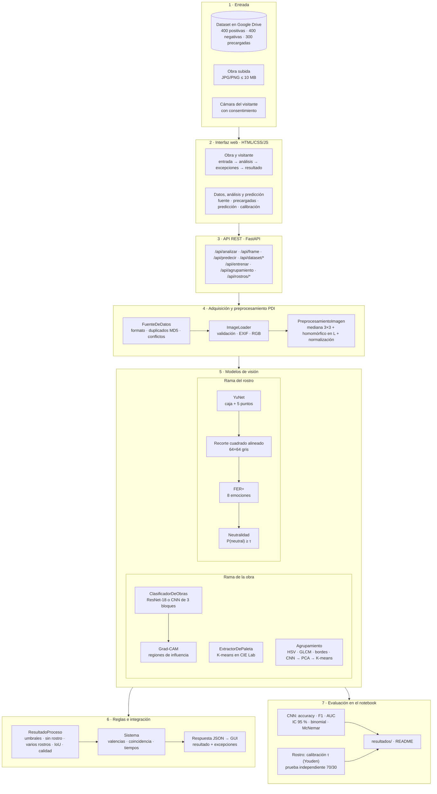

# Expresión humana en obras de arte: CNN, filtrado PDI y neutralidad facial

**Procesamiento Digital de Imágenes · Universidad Autónoma de Occidente · 2026-2**
Jose Gabriel Castañeda Uribe · Juan José Osorio Reyes · Profesor: Nicolás Llanos Neuta

Sistema interactivo que **clasifica el carácter emocional de una obra de arte** (positiva / negativa) con una CNN, **detecta los rostros** de la obra o del visitante y decide si su expresión es **neutral o no neutral**, y presenta todo en una **aplicación web** con manejo de excepciones. Se enmarca en el eje *Análisis de la Expresión Humana en el Arte y la Cultura*.

| | |
|---|---|
| 📓 Notebook completo (código, salidas y aplicativo) | [`proyecto/ProyectoPDI_Completo.ipynb`](proyecto/ProyectoPDI_Completo.ipynb) |
| 🖥️ Interfaz gráfica (HTML/CSS/JS) | [`proyecto/interfaz/`](proyecto/interfaz/) |
| 📊 Resultados detallados | [`results/RESULTADOS.md`](results/RESULTADOS.md) · [`results/resultados.json`](results/resultados.json) |
| 🧭 Arquitectura del sistema | [`docs/arquitectura.md`](docs/arquitectura.md) |
| 📘 Documentación técnica | [`docs/DOCUMENTACION.md`](docs/DOCUMENTACION.md) |
| 📁 Dataset y modelos (Google Drive) | [Carpeta del proyecto](https://drive.google.com/drive/folders/1paeP4lWNFA2-x0T6irA_UrRZ3m_i2y3n?usp=sharing) |
| 🎬 Video demostrativo (≤ 3 min) | *(enlace pendiente)* |
| 🖼️ Póster académico | *(`docs/poster.pdf` pendiente)* |

<!-- AUTO:FECHA -->

### Resultados principales

<!-- AUTO:RESUMEN -->

---

## Contenido

1. [Descripción del proyecto](#1-descripción-del-proyecto)
2. [Arquitectura del sistema](#2-arquitectura-del-sistema)
3. [Metodología](#3-metodología)
4. [Implementación](#4-implementación)
5. [Datos](#5-datos)
6. [Interfaz gráfica de usuario](#6-interfaz-gráfica-de-usuario)
7. [Resultados](#7-resultados)
8. [Conclusiones](#8-conclusiones)
9. [Instalación y ejecución](#9-instalación-y-ejecución)
10. [Referencias](#10-referencias)

---

## 1. Descripción del proyecto

**Problemática.** Una obra de arte transmite emoción por dos canales: su apariencia global (color, iluminación, textura y composición) y la expresión de los rostros que contiene o de las personas que la observan. En museos y exposiciones casi nunca se mide si una obra produce la reacción que su contenido sugiere: las encuestas de salida son tardías, subjetivas y no dicen qué parte de la obra influyó.

**Justificación.** El procesamiento digital de imágenes y la visión computacional permiten medir, sin contacto y en segundos, el carácter emocional de una obra y la expresión facial de un rostro. Un sistema así sirve como herramienta de apoyo para curaduría, mediación educativa y estudios de público, siempre que sus resultados se reporten con sus límites (tamaño de muestra, subjetividad de las etiquetas y dominio de los modelos faciales).

**Objetivo general.** Diseñar, implementar y evaluar un sistema interactivo basado en técnicas de procesamiento digital de imágenes y visión computacional que analice la expresión humana en obras de arte: el carácter emocional de la obra y la expresión de los rostros presentes en ella o en quien la observa.

**Objetivos específicos.**

1. Construir y validar un dataset propio de 1 100 obras: 400 positivas, 400 negativas y 300 sin etiqueta.
2. Aplicar filtrado espacial (mediana), en frecuencia (homomórfico) y normalización estadística, y medir su efecto en la clasificación.
3. Entrenar y comparar dos arquitecturas de CNN (*transfer learning* con ResNet-18 y una CNN desde cero) y evaluarlas con accuracy, precision, recall, F1, AUC, matriz de confusión, intervalos de confianza y pruebas estadísticas.
4. Detectar rostros y decidir si su expresión es neutral o no neutral con un umbral calibrado y evaluado con fotos reales capturadas por el equipo.
5. Integrar todo en una interfaz gráfica con manejo de excepciones y documentarlo en este repositorio.

**Solución propuesta.** Un notebook de Google Colab que valida los datos, entrena y evalúa los modelos y levanta una aplicación web (FastAPI + HTML/CSS/JS). En la aplicación el usuario sube o elige una obra y, opcionalmente, activa la cámara: el sistema clasifica la obra, muestra el mapa Grad-CAM y la paleta cromática, analiza cada rostro (emoción, neutralidad y calidad del rostro) y compara la valencia de la obra con la expresión del visitante.

---

## 2. Arquitectura del sistema



La tabla de módulos, el flujo de una petición y los formatos de entrada y salida están en [`docs/arquitectura.md`](docs/arquitectura.md).

---

## 3. Metodología

| Etapa | Qué se hizo | Técnicas |
|---|---|---|
| 1. Datos | Recopilación de 1 100 obras y etiquetado manual por el equipo (positiva / negativa); 300 obras sin etiqueta para consulta | Validación de formato, legibilidad, tamaño; duplicados por MD5; detección de fuga de datos entre grupos |
| 2. Partición | Estratificada por clase con semilla fija: 80 % entrenamiento, 10 % validación, 10 % prueba | La misma partición para todas las configuraciones |
| 3. Preprocesamiento PDI | Reducción a 512 px, **mediana 3×3** (ruido impulsivo), **filtro homomórfico** sobre el canal L de CIE Lab (corrige iluminación no uniforme y realza detalle), redimensión a 224×224 y normalización con media/desviación del entrenamiento | Filtrado espacial, filtrado en frecuencia (FFT), normalización estadística |
| 4. Modelos | **ResNet-18 preentrenada** (se congelan `conv1`–`layer2`) y **CNN de 3 bloques** desde cero; cada una **con y sin filtrado PDI** (4 configuraciones) | *Transfer learning*, Dropout 0.5, Weight Decay 1e-4, Early Stopping (paciencia 5), aumento de datos (volteo y rotación ±10°) |
| 5. Selección | Se elige la configuración con **menor pérdida de validación**; la prueba solo se usa para reportar | Evita sobreajustar la elección al conjunto de prueba |
| 6. Evaluación | Accuracy, precision, recall, F1, AUC, matriz de confusión, curva ROC, **IC 95 % de Wilson**, **prueba binomial** frente al azar y **prueba de McNemar** entre arquitecturas | Errores con mayor seguridad para análisis cualitativo |
| 7. Explicabilidad | **Grad-CAM** sobre el último bloque convolucional y **paleta cromática** (K-means en CIE Lab) | Regiones de mayor influencia y colores dominantes |
| 8. Exploración no supervisada | Color (histograma HSV), textura (**GLCM**), bordes (Sobel, Laplaciano) y características de la CNN → PCA → **K-means** con k por silueta; ARI con las etiquetas | Análisis de si la apariencia por sí sola separa las clases |
| 9. Rostros | **YuNet** (caja + 5 puntos faciales), recorte cuadrado con relleno y **alineado por los ojos**, **FER+** (8 emociones) y decisión **neutral si P(neutral) ≥ τ** | Reglas para sin rostro, varios rostros y seguimiento entre fotogramas (IoU ≥ 0.3) |
| 10. Calibración facial | Fotos reales capturadas por el equipo con la cámara del aplicativo; τ por **índice de Youden** y **evaluación independiente** 70 % / 30 % | AUC, exactitud balanceada |
| 11. Integración | API FastAPI + interfaz web; valencia de la obra = P(positivo) − P(negativo); valencia del rostro = Σ P(emoción)·valencia(emoción); **coincidencia = 1 − \|v<sub>obra</sub> − v<sub>rostro</sub>\| / 2** | Manejo de excepciones con mensajes comprensibles |

---

## 4. Implementación

```
PDI-Proyecto-final/
├── README.md                          ← este documento
├── requirements.txt
├── proyecto/
│   ├── ProyectoPDI_Completo.ipynb     ← notebook completo, con salidas (datos, modelos, resultados y aplicativo)
│   └── interfaz/                      ← index.html · styles.css · app.js (la sirve el notebook con FastAPI)
├── docs/
│   ├── arquitectura.md                ← diagrama, módulos y flujo de una petición
│   ├── DOCUMENTACION.md               ← celdas, clases, API, fórmulas, excepciones y parámetros
│   └── gui/                           ← prototipos (SVG) y capturas de la interfaz
└── results/
    ├── RESULTADOS.md                  ← tablas y figuras de la ejecución entregada
    ├── resultados.json                ← todas las cifras en formato máquina
    ├── metricas_cnn.json              ← métricas, historial y predicciones de las 4 configuraciones
    ├── particion_cnn.json             ← qué imagen quedó en entrenamiento, validación o prueba
    ├── umbral_neutralidad.json        ← calibración facial
    └── figuras/                       ← todas las gráficas generadas por el notebook
```

| Sección del notebook | Qué hace |
|---|---|
| 1. Configuración | Instala lo que falte, monta Google Drive, localiza la carpeta del proyecto y define rutas y parámetros en una sola celda (`config`) |
| 2. Datos | `ImageLoader` (`cargar_imagen`) y `FuenteDeDatos` validan cada archivo, detectan duplicados y conflictos, y describen el dataset |
| 3. Preprocesamiento y modelos | Filtro homomórfico y `PreprocesamientoImagen`; partición; arquitecturas `CNNResNet18` y `CNN`; entrenamiento de las 4 configuraciones o carga del modelo guardado; `ExtractorDePaleta`; `AnalizarGestosFaciales`; `ResultadoProceso`; calibración; agrupamiento |
| 4. Predicción | `ClasificadorDeObras` (con Grad-CAM), `Sistema` (integra todo) y `predecir_imagen` con un ejemplo |
| 5. Resultados y aplicativo | Curvas, métricas, ROC, comparación de configuraciones, errores, agrupamiento; servidor FastAPI y enlace público |
| 6. Evaluación facial y repositorio | Fotos del equipo, calibración de τ, evaluación independiente, conclusiones generadas desde los resultados, capturas de la GUI y armado de este repositorio |

La descripción de cada clase, función y endpoint está en [`docs/DOCUMENTACION.md`](docs/DOCUMENTACION.md).

---

## 5. Datos

**Origen.** Las imágenes fueron **recopiladas por el equipo** a partir de obras de arte publicadas en internet y en repositorios de obras de arte.

**Etiquetado.** Cada obra fue **revisada y etiquetada manualmente por el equipo**:

- **Positiva:** transmite una sensación agradable o serena (alegría, calma, ternura, celebración).
- **Negativa:** transmite una sensación inquietante o tensa (tristeza, miedo, violencia, angustia).
- **Precargadas:** no se etiquetaron y no se usan para entrenar; sirven como base de consulta en la interfaz y para el agrupamiento.

**Fotos del equipo.** Para evaluar la decisión neutral / no neutral, los integrantes capturaron fotos con la cámara del propio aplicativo (botones «Guardar como neutral / no neutral»). Se guardan en `rostros_eval/` del Drive y no se publican en este repositorio; solo se muestra una muestra en las figuras de resultados.

**Acceso.** Dataset, modelos entrenados y fotos de evaluación: [carpeta del proyecto en Google Drive](https://drive.google.com/drive/folders/1paeP4lWNFA2-x0T6irA_UrRZ3m_i2y3n?usp=sharing).

```
Proyecto Final PDI VERSION 3/            (Google Drive)
├── dataset usado/
│   ├── Positivo/                400 obras
│   ├── Negativo/                400 obras
│   └── Precarga sin analizar/   300 obras sin etiqueta
├── modelos_app/                 CNN entrenada, métricas, partición, umbral, YuNet y FER+
├── rostros_eval/                fotos del equipo (neutral / no_neutral)
└── interfaz/                    index.html · styles.css · app.js
```

<!-- AUTO:DATOS -->

---

## 6. Interfaz gráfica de usuario

### Prototipos

El diseño partió de dos flujos: el del **visitante** (una obra y su expresión) y el de **datos y predicción** (fuente, precargadas, predicción y calibración).

| Flujo «Obra y visitante» | Flujo «Datos, análisis y predicción» |
|---|---|
|  |  |

### Funcionalidades

| Pestaña / paso | Funcionalidad |
|---|---|
| **Obra y visitante · 1. Entrada** | Cargar una obra (JPG/PNG ≤ 10 MB, arrastrar o seleccionar). Activar la cámara con consentimiento; vista en vivo con emoción, rostro, neutralidad, calificación del rostro e iluminación. Guardar fotos etiquetadas para la evaluación de neutralidad |
| 2. Análisis | Observación de 3, 6 o 10 s con la obra en pantalla completa y avance por módulo |
| 3. Excepciones | Avisos comprensibles: imagen oscura, sobreexpuesta o borrosa, rostro no detectado, varios rostros, confianza baja, entrada incompleta |
| 4. Resultado | Categoría de la obra con su probabilidad, Grad-CAM y regiones, paleta, rostros de la obra, emoción y neutralidad del visitante, coincidencia, línea de tiempo y tiempos por módulo. Exportable a JSON o PDF |
| **Datos, análisis y predicción · 1. Fuente** | Cargar y validar una carpeta local o de Google Drive; resumen por grupo y archivos descartados; reentrenar la CNN |
| 2. Precargadas | Mostrar obras al azar y analizarlas con el mismo flujo; agrupamiento no supervisado |
| 3. Predicción | Subir una imagen y obtener, para cada rostro, la decisión neutral / no neutral con su probabilidad y la categoría de la obra; calibrar el umbral con las fotos del equipo |
| Acerca del modelo | Arquitectura, métricas en prueba, matriz de confusión y curva de pérdida |

### Instrucciones de uso

1. Ejecuta el notebook (sección [9](#9-instalación-y-ejecución)) y abre el aplicativo con el enlace **«Abrir el aplicativo»** o con el enlace público (`https://….loca.lt`; la contraseña es la IP que imprime la celda).
2. **Analizar una obra:** en «Obra y visitante» arrastra la imagen al recuadro y pulsa **Confirmar y analizar**. Revisa los avisos (paso 3) y pulsa **Ver resultado**.
3. **Comparar con tu expresión:** marca el consentimiento, pulsa **Activar cámara** e **Iniciar observación**; mira la obra los segundos elegidos y revisa la coincidencia.
4. **Predecir sobre una imagen nueva:** en «Datos, análisis y predicción» → «Predicción», sube una foto u obra.
5. **Explorar el dataset:** pulsa **Mostrar precargadas al azar** o **Agrupar precargadas**.
6. **Calibrar la neutralidad:** con la cámara encendida usa **Guardar como neutral / no neutral** y luego **Calibrar umbral con mis fotos** (o ejecuta la sección 6 del notebook).

### Evidencias visuales

<!-- AUTO:GUI -->

---

## 7. Resultados

<!-- AUTO:RESULTADOS -->

---

## 8. Conclusiones

<!-- AUTO:CONCLUSIONES -->

---

## 9. Instalación y ejecución

### Google Colab (recomendado)

1. Agrega la [carpeta del proyecto](https://drive.google.com/drive/folders/1paeP4lWNFA2-x0T6irA_UrRZ3m_i2y3n?usp=sharing) a tu Drive: *Compartido conmigo* → clic derecho → *Organizar → Agregar acceso directo → Mi unidad*.
2. Abre `proyecto/ProyectoPDI_Completo.ipynb` en Colab (*Archivo → Abrir cuaderno → GitHub*, o súbelo a Drive).
3. *Entorno de ejecución → Cambiar tipo de entorno →* **T4 GPU**.
4. *Entorno de ejecución →* **Ejecutar todo** y autoriza el acceso a Drive. Si el modelo ya está en `modelos_app/`, se carga y la ejecución tarda pocos minutos; si no, se entrenan las 4 configuraciones (unos 10–15 min).
5. Abre el aplicativo con el enlace de la sección 5. Para repetir la evaluación facial, captura fotos y ejecuta la sección 6 (**Ctrl+F10**: ejecutar desde la celda seleccionada hacia abajo).

Parámetros principales en la celda `config`: `REENTRENAR` (`"auto"`, `True` o `False`), `ARQUITECTURAS`, `TUNEL_PUBLICO`, `CAPTURAS_GUI` y los umbrales de detección y neutralidad.

### Local (Python 3.10+)

```bash
git clone https://github.com/Ryuukatsuro25/PDI-Proyecto-final.git
cd PDI-Proyecto-final
pip install -r requirements.txt jupyter
# copia «dataset usado/» (desde Drive) dentro de proyecto/
cd proyecto
jupyter notebook ProyectoPDI_Completo.ipynb   # Ejecutar todo
# el aplicativo queda en http://127.0.0.1:8000
```

Fuera de Colab el notebook usa las carpetas junto a él: `proyecto/dataset usado/`, `proyecto/interfaz/` y crea `proyecto/app_pdi/modelos/` y `proyecto/resultados/`.

---

## 10. Referencias

- Achlioptas, P., Ovsjanikov, M., Haydarov, K., Elhoseiny, M. y Guibas, L. (2021). *ArtEmis: Affective Language for Visual Art*. CVPR.
- Barsoum, E., Zhang, C., Canton Ferrer, C. y Zhang, Z. (2016). *Training Deep Networks for Facial Expression Recognition with Crowd-Sourced Label Distribution* (FER+). ICMI.
- Gonzalez, R. C. y Woods, R. E. (2018). *Digital Image Processing* (4.ª ed.). Pearson. (Filtrado espacial, filtrado homomórfico).
- Haralick, R. M., Shanmugam, K. y Dinstein, I. (1973). *Textural Features for Image Classification*. IEEE Transactions on Systems, Man, and Cybernetics.
- He, K., Zhang, X., Ren, S. y Sun, J. (2016). *Deep Residual Learning for Image Recognition*. CVPR.
- McNemar, Q. (1947). *Note on the sampling error of the difference between correlated proportions or percentages*. Psychometrika.
- Selvaraju, R. R. et al. (2017). *Grad-CAM: Visual Explanations from Deep Networks via Gradient-based Localization*. ICCV.
- Wilson, E. B. (1927). *Probable inference, the law of succession, and statistical inference*. Journal of the American Statistical Association.
- Wu, W., Peng, H. y Yu, S. (2023). *YuNet: A Tiny Millisecond-level Face Detector*. Machine Intelligence Research.
- Youden, W. J. (1950). *Index for rating diagnostic tests*. Cancer.
