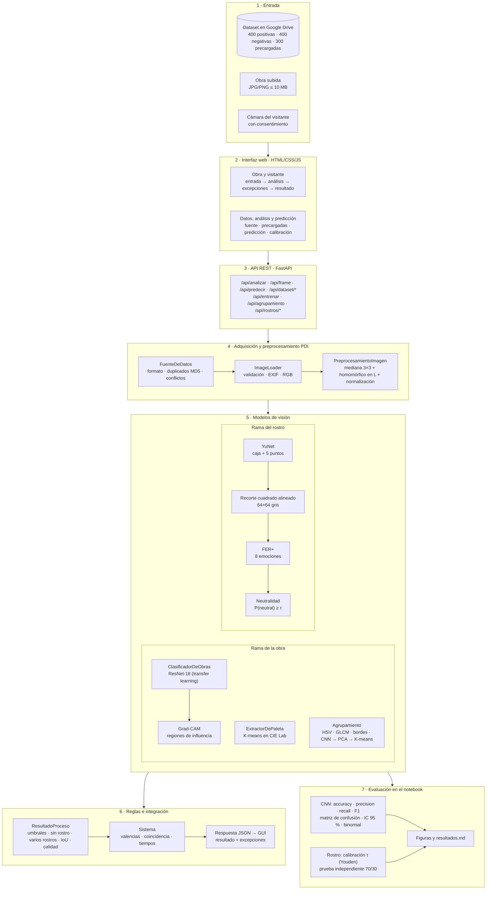
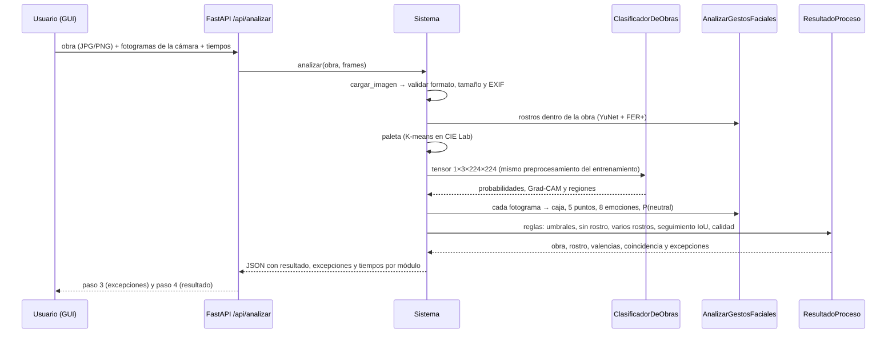
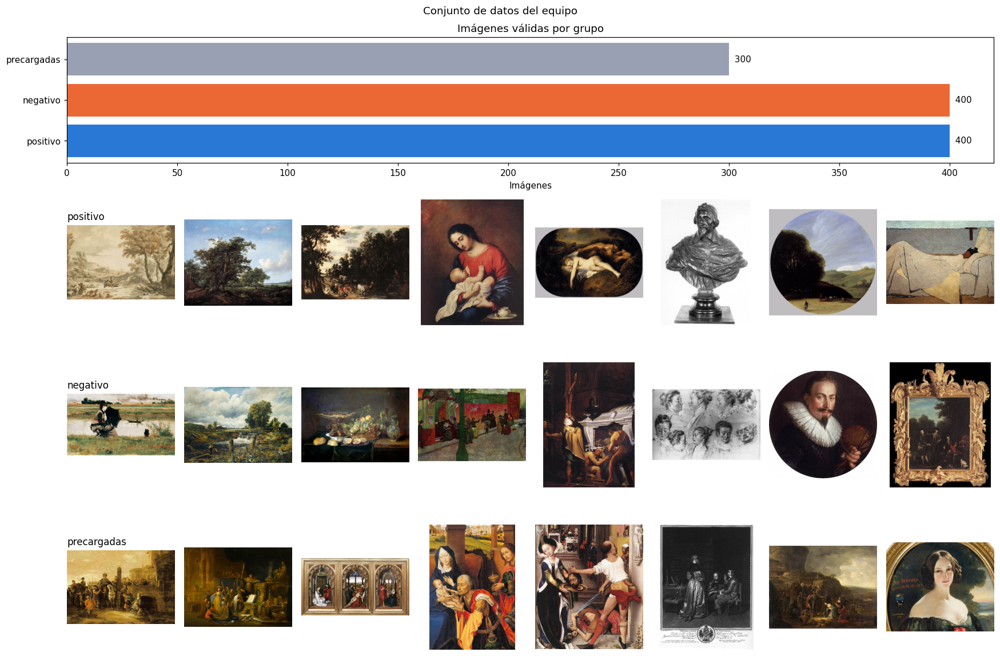
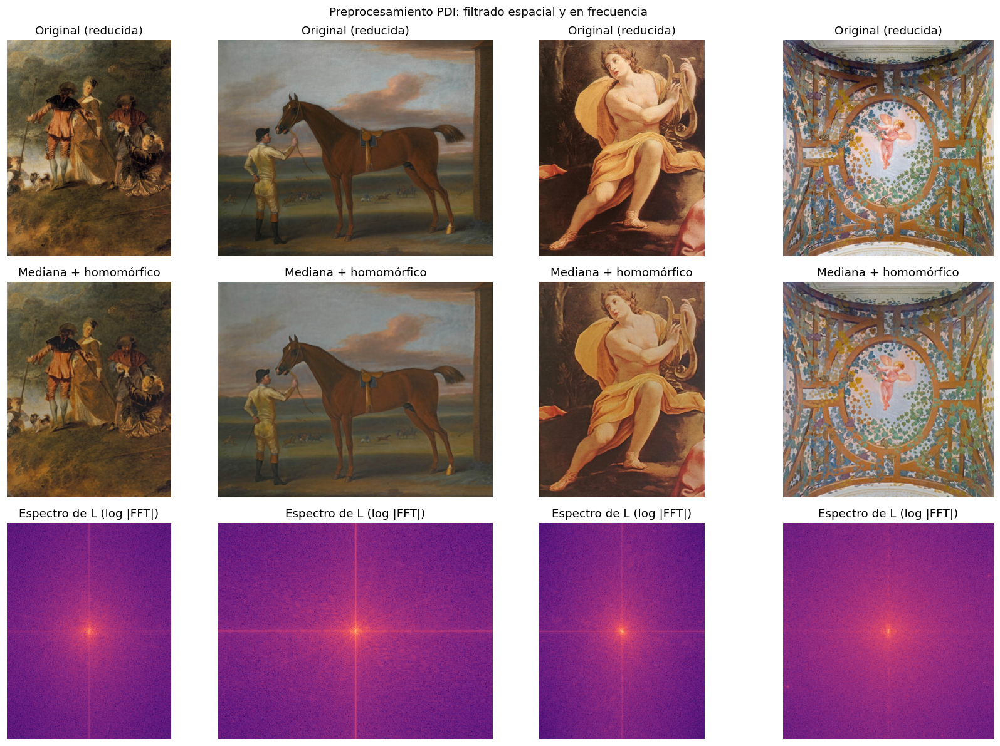
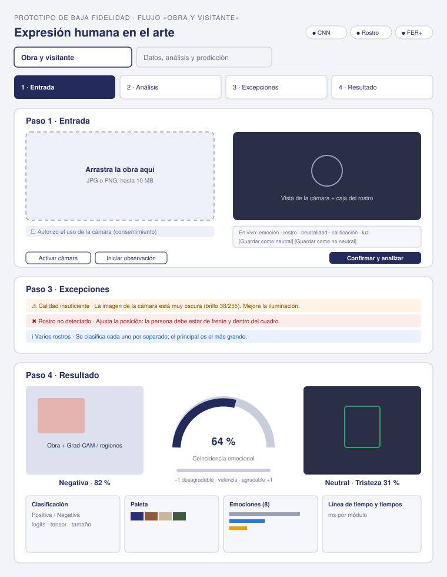
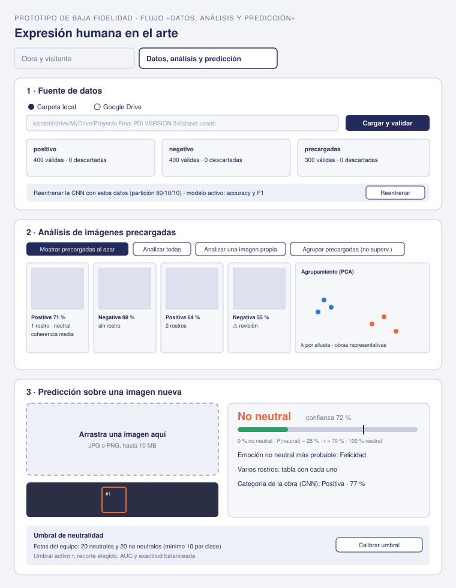
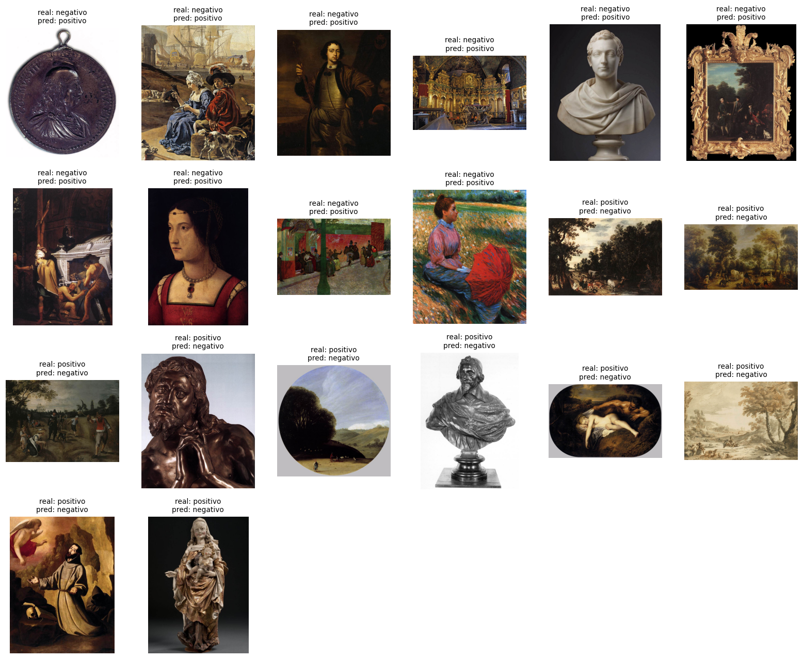
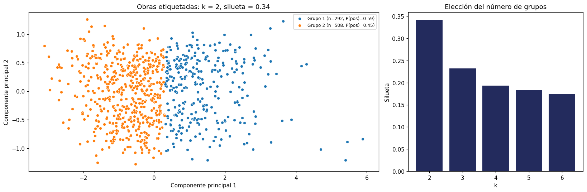
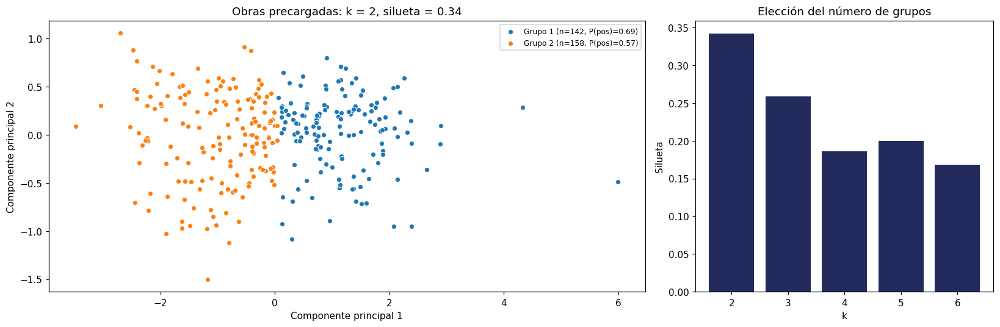
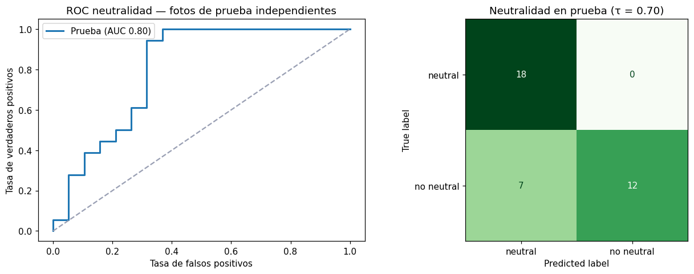

# Expresión humana en obras de arte: CNN, filtrado PDI y neutralidad facial

**Procesamiento Digital de Imágenes · Universidad Autónoma de Occidente · 2026-2**
Jose Gabriel Castañeda Uribe · Juan José Osorio Reyes · Profesor: Nicolás Llanos Neuta

Este proyecto es un sistema interactivo que:

- **clasifica el carácter emocional de una obra de arte** (positiva o negativa) con una red neuronal convolucional;
- **detecta los rostros** que aparecen en la obra o en quien la observa por cámara, y decide si cada expresión es **neutral o no neutral**;
- muestra todo en una **aplicación web** en español con manejo de excepciones.

Se enmarca en el eje temático *Análisis de la Expresión Humana en el Arte y la Cultura*.

| Recurso | Enlace |
|---|---|
| 📓 Notebook completo (código, salidas y aplicativo) | [`proyecto/ProyectoPDI_Completo_FINALl (1).ipynb`](proyecto/ProyectoPDI_Completo_FINALl%20%281%29.ipynb) |
| 🖥️ Interfaz gráfica (HTML, CSS, JS) | [`proyecto/Interfaz/`](proyecto/Interfaz/) |
| 📊 Resultados y figuras de la ejecución entregada | [`proyecto/resultados_20261123_1926/`](proyecto/resultados_20261123_1926/) |
| 🧠 Métricas, partición y umbral del modelo | [`proyecto/modelos_app/`](proyecto/modelos_app/) |
| 📁 Dataset, modelos entrenados y fotos de evaluación | [Carpeta del proyecto en Google Drive](https://drive.google.com/drive/folders/1paeP4lWNFA2-x0T6irA_UrRZ3m_i2y3n?usp=sharing) |
| 🎬 Video demostrativo (máximo 3 min) | [`WhatsApp Video 2026-11-25 at 2.07.26 AM.mp4`](WhatsApp%20Video%202026-11-25%20at%202.07.26%20AM.mp4) |
| 🖼️ Póster académico | [`Despliegue web (1).pdf`](Despliegue%20web%20%281%29.pdf) |
| 🧑 Fotos de evaluación de la neutralidad facial | [`proyecto/rostros_eval/`](proyecto/rostros_eval/) |

### Resultados principales

| Indicador | Resultado |
|---|---|
| Modelo elegido (por pérdida de validación) | ResNet-18 preentrenada, sin filtros PDI |
| Accuracy en prueba (80 obras nunca vistas) | **0.750**, con IC 95 % de Wilson de 0.65 a 0.83 |
| Precision · Recall · F1 | 0.750 · 0.750 · **0.750** |
| ¿Es mejor que el azar? (prueba binomial) | Sí: p < 0.0001 |
| Línea base: CNN de 3 bloques entrenada desde cero | Accuracy 0.600 (IC 95 % de 0.49 a 0.70) · F1 0.556 |
| Neutralidad facial, con fotos de prueba no usadas para calibrar (37) | AUC **0.801** · exactitud balanceada **0.816** con τ = 0.70 |
| Agrupamiento no supervisado frente a las etiquetas | ARI = 0.013: los grupos visuales no reproducen la emoción |

---

## Contenido

1. [Descripción del proyecto](#1-descripción-del-proyecto)
2. [Arquitectura del sistema](#2-arquitectura-del-sistema)
3. [Metodología](#3-metodología)
4. [Implementación](#4-implementación)
5. [Datos](#5-datos)
6. [Interfaz gráfica de usuario](#6-interfaz-gráfica-de-usuario)
7. [Resultados](#7-resultados)
8. [Conclusiones](#8-conclusiones)
9. [Instalación y ejecución](#9-instalación-y-ejecución)
10. [Referencias](#10-referencias)

---

## 1. Descripción del proyecto

### Problemática

Una obra de arte transmite emoción por dos canales:

- su **apariencia global**: color, iluminación, textura y composición;
- la **expresión de los rostros** que contiene o de las personas que la observan.

En museos y exposiciones casi nunca se mide si una obra produce la reacción que su contenido sugiere. Las encuestas de salida llegan tarde, son subjetivas y no dicen qué parte de la obra influyó en la reacción.

### Justificación

El procesamiento digital de imágenes y la visión por computador permiten medir, sin contacto y en segundos, dos cosas: el carácter emocional de una obra y la expresión de un rostro. Una herramienta así sirve de apoyo para la curaduría, la mediación educativa y los estudios de público, siempre que reporte sus resultados con sus límites:

- el tamaño de la muestra;
- la subjetividad de las etiquetas;
- el dominio de los modelos faciales, entrenados con fotografías y no con pinturas.

### Objetivo general

Diseñar, implementar y evaluar un sistema interactivo de procesamiento digital de imágenes y visión por computador que analice la expresión humana en obras de arte, tanto en el carácter emocional de la obra como en la expresión de los rostros presentes en ella o en quien la observa.

### Objetivos específicos

1. Construir y validar un dataset propio de 1 100 obras: 400 positivas, 400 negativas y 300 sin etiqueta.
2. Aplicar filtrado espacial (mediana), filtrado en frecuencia (homomórfico) y normalización estadística, y medir su efecto en la clasificación.
3. Entrenar y evaluar una CNN con accuracy, precision, recall, F1, matriz de confusión, intervalos de confianza y una prueba estadística frente al azar, y compararla con una línea base.
4. Detectar rostros y decidir si su expresión es neutral o no neutral, con un umbral calibrado y evaluado con **fotografías reales de personas, previamente registradas** (datos externos al dataset de obras).
5. Integrar todo en una interfaz gráfica con manejo de excepciones y documentarlo en este repositorio.

### Solución propuesta

Un notebook de Google Colab que hace cuatro cosas:

1. valida los datos;
2. entrena o carga los modelos;
3. evalúa los resultados;
4. levanta una aplicación web (FastAPI en el servidor; HTML, CSS y JavaScript en el navegador).

En la aplicación, el usuario sube o elige una obra y, si quiere, activa la cámara. El sistema entonces:

- clasifica la obra y muestra el mapa Grad-CAM con las zonas que más pesaron;
- extrae la paleta cromática;
- analiza cada rostro: emoción, neutralidad y calidad;
- compara la valencia emocional de la obra con la expresión del visitante y entrega una **coincidencia emocional**.

---

## 2. Arquitectura del sistema



### Flujo de una petición «Confirmar y analizar»



### Módulos

| Módulo | Entrada | Salida | Técnica |
|---|---|---|---|
| `ImageLoader` (`cargar_imagen`) | Bytes de un archivo o fotograma | Arreglo RGB `uint8` | Valida JPG/PNG, ≤ 10 MB, ≥ 32 px; corrige la orientación EXIF |
| `FuenteDeDatos` | Carpeta local o de Drive | Reporte por grupo, imágenes válidas y descartadas | Alias de carpetas, MD5 para duplicados, conflictos de etiqueta, detección de fuga de datos |
| `PreprocesamientoImagen` | Imagen RGB | Tensor normalizado 1×3×224×224 | Mediana 3×3 + filtro homomórfico en L (CIE Lab) si el modelo se entrenó con filtros; normalización con la media y desviación del entrenamiento |
| `CNNResNet18` / `CNN` | Tensor | Logits [negativo, positivo] y vector de 128 características | ResNet-18 preentrenada con `layer3`, `layer4` y la cabeza ajustados / CNN de 3 bloques desde cero (línea base) |
| `ClasificadorDeObras` | Tensor | Probabilidades, Grad-CAM y regiones | Lee la arquitectura, la normalización y los filtros guardados con el modelo |
| `ExtractorDePaleta` | Imagen RGB | 6 colores (HEX, nombre, proporción), brillo, saturación, calidez | K-means en CIE Lab |
| `AnalizarGestosFaciales` | Imagen RGB | Rostros con caja, puntos, 8 emociones, neutralidad, gestos y calificación (0–100) | YuNet; recorte cuadrado con relleno y alineado por los ojos; FER+ sobre 64×64 en gris |
| `ResultadoProceso` | Salidas de los módulos | Resultado validado y excepciones | Umbrales de confianza, rostro principal = el más grande, seguimiento por IoU ≥ 0.3, calidad (brillo y nitidez) |
| `calibrar_neutralidad` | Fotos etiquetadas neutral / no neutral (`rostros_eval/`) | τ, recorte elegido, AUC, exactitud balanceada | Curva ROC e índice de Youden; AUC mínimo de 0.6 |
| `agrupar_imagenes` | Lista de obras | k, silueta, ARI, grupos y obras representativas | Histograma HSV, GLCM, Sobel/Laplaciano y características de la CNN → PCA → K-means |
| `Sistema` | Peticiones de la API | Respuestas JSON | Integra todos los módulos y mide el tiempo de cada uno |

---

## 3. Metodología

| Etapa | Qué se hizo | Técnicas |
|---|---|---|
| 1. Datos | Recopilación de 1 100 obras y etiquetado manual por el equipo (positiva / negativa); 300 obras sin etiqueta para consulta | Validación de formato, legibilidad y tamaño; duplicados por MD5; control de fuga de datos entre grupos |
| 2. Partición | Estratificada por clase con semilla 42: 640 entrenamiento, 80 validación, 80 prueba | La misma partición para todos los modelos comparados |
| 3. Preprocesamiento PDI | Reducción a 512 px. **Mediana 3×3** contra el ruido impulsivo. **Filtro homomórfico** sobre el canal L de CIE Lab, que corrige la iluminación no uniforme y realza el detalle. Redimensión a 224×224 y normalización con la media y la desviación del entrenamiento | Filtrado espacial, filtrado en frecuencia (FFT), normalización estadística |
| 4. Modelos | **ResNet-18 preentrenada en ImageNet** (`conv1`–`layer2` congeladas, tasa de aprendizaje 1e-4) y, como línea base, una **CNN de 3 bloques desde cero** (tasa 1e-3). Cada una se entrenó **con y sin filtrado PDI** | *Transfer learning*, Dropout 0.5, Weight Decay 1e-4, Early Stopping (paciencia 5), aumento de datos (volteo horizontal y rotación de ±10°) |
| 5. Selección | Se conserva la variante con **menor pérdida de validación**; el conjunto de prueba solo se usa para reportar | Evita ajustar la elección al conjunto de prueba |
| 6. Evaluación | Accuracy, precision, recall, F1, matriz de confusión, **IC 95 % de Wilson** y **prueba binomial** frente al azar; análisis de las obras mal clasificadas | Comparación con la línea base sobre la misma partición |
| 7. Explicabilidad | **Grad-CAM** sobre el último bloque convolucional y **paleta cromática** | Muestra qué zonas y qué colores pesaron |
| 8. Exploración no supervisada | Color (histograma HSV), textura (**GLCM**), bordes (Sobel, Laplaciano) y características de la CNN → PCA → **K-means** con k elegido por silueta; ARI frente a las etiquetas | Comprueba si la apariencia por sí sola separa las clases |
| 9. Rostros | **YuNet** (caja + 5 puntos faciales) → recorte cuadrado con relleno y **alineado por los ojos** → **FER+** (8 emociones) → **neutral si P(neutral) ≥ τ** | Reglas para sin rostro, varios rostros y seguimiento entre fotogramas (IoU ≥ 0.3) |
| 10. Calibración facial | 122 fotografías reales de personas, previamente registradas y etiquetadas neutral / no neutral; τ por **índice de Youden**; **evaluación independiente** 70 % / 30 % | AUC y exactitud balanceada |
| 11. Integración | API FastAPI + interfaz web. Valencia de la obra = P(positivo) − P(negativo). Valencia del rostro = Σ P(emoción)·valencia(emoción). **Coincidencia = 1 − \|v<sub>obra</sub> − v<sub>rostro</sub>\| / 2** | Excepciones con mensajes comprensibles |

---

## 4. Implementación

### Estructura del repositorio

```
PDI-Proyecto-final/
├── README.md                                  ← este documento
├── docs/gui/                                  ← prototipos de la interfaz (SVG)
└── proyecto/
    ├── ProyectoPDI_Completo_FINALl (1).ipynb  ← notebook completo con sus salidas
    ├── Interfaz/                              ← index.html · styles.css · app.js
    ├── modelos_app/                           ← métricas, partición y umbral de neutralidad
    │                                             (los pesos .pt y .onnx están en Drive)
    ├── modelos_app_respaldo_20261123_1828/    ← métricas de la línea base (CNN de 3 bloques)
    ├── resultados_20261123_1926/              ← figuras y resultados.md de la ejecución entregada
    └── resultados_cnn/                        ← experimento exploratorio previo (validación cruzada)
```

### Secciones del notebook

| Sección | Qué hace |
|---|---|
| 1. Importaciones y configuración | Instala lo que falte, importa las librerías y detecta la GPU. Monta Google Drive y localiza la carpeta del proyecto por su enlace o por su nombre. Define rutas y parámetros en una única celda (`config`). Cada figura se guarda automáticamente en `resultados/` |
| 2. Carga del dataset | `cargar_imagen` (lectura segura) y `FuenteDeDatos` validan cada archivo, detectan duplicados y conflictos de etiqueta, y muestran una muestra por grupo |
| 3. Preprocesamiento y rostros | Varias piezas:<br/>• modelos YuNet y FER+;<br/>• filtro homomórfico y `PreprocesamientoImagen`;<br/>• partición 80/10/10 y conjuntos con y sin filtros;<br/>• arquitecturas `CNNResNet18` y `CNN`, con su entrenamiento (con respaldo previo del modelo) o su carga;<br/>• `ExtractorDePaleta`, `AnalizarGestosFaciales` y `ResultadoProceso`;<br/>• calibración del umbral y agrupamiento no supervisado |
| 4. Predicción | `ClasificadorDeObras` (con Grad-CAM), `Sistema` (integra todo) y `predecir_imagen`, con un ejemplo sobre una obra precargada |
| 5. Interfaz y resultados | Resultados: curvas, métricas, matriz de confusión, comparación con y sin filtros y frente a la línea base, obras mal clasificadas, agrupamiento, calibración y evaluación independiente de la neutralidad, exportación de `resultados.md` y conclusiones. Aplicativo: servidor FastAPI en un hilo, enlace de Colab y túnel público opcional |

### API del aplicativo

| Método y ruta | Uso |
|---|---|
| `GET /` · `GET /{archivo}` | Sirve `index.html`, `styles.css` y `app.js` desde la carpeta de la interfaz |
| `GET /api/estado` · `GET /api/metricas` | Estado de los modelos, umbrales, calibración y métricas de la CNN |
| `POST /api/frame` | Análisis de un fotograma de la cámara (vista en vivo) |
| `POST /api/analizar` | Análisis completo: obra + fotogramas → clasificación, rostros, coincidencia y excepciones |
| `POST /api/predecir` | Neutralidad de cada rostro y categoría de la obra para una imagen nueva |
| `GET /api/datos/estado` · `POST /api/datos/cargar` | Carga y validación de la fuente de datos (carpeta local o Drive) |
| `POST /api/entrenar` | Reentrenamiento de la CNN en segundo plano |
| `GET /api/dataset/estado` · `GET /api/dataset/aleatorias` · `GET /api/dataset/imagen` | Obras precargadas |
| `POST /api/dataset/analizar` · `POST /api/dataset/predecir` | Análisis o predicción sobre una precargada |
| `POST /api/agrupamiento` | Agrupamiento no supervisado de las precargadas |
| `GET /api/rostros/estado` · `POST /api/rostros/guardar` · `POST /api/rostros/calibrar` | Fotos etiquetadas para la neutralidad y calibración de τ |

### Fórmulas

| Concepto | Fórmula |
|---|---|
| Filtro homomórfico | `H(u,v) = (γH − γL)·(1 − exp(−c·D²/D0²)) + γL`, aplicado a `FFT(log(1 + L))`, con γL = 0.75 y γH = 1.25 |
| Normalización | `x' = (x − μ) / σ` por canal, con μ y σ del conjunto de entrenamiento |
| Valencia de la obra | `P(positivo) − P(negativo)` ∈ [−1, 1] |
| Valencia del rostro | `Σ P(emoción)·valencia(emoción)`, con felicidad +1, sorpresa +0.3, neutral 0, desprecio −0.5, miedo −0.7, tristeza −0.8, asco −0.8, enojo −0.9 |
| Coincidencia emocional | `1 − |v_obra − v_rostro| / 2` ∈ [0, 1] |
| Decisión de neutralidad | neutral si `P(neutral) ≥ τ` |
| Índice de Youden | `τ* = argmax (TPR − FPR)` |
| IC 95 % de Wilson | `(p̂ + z²/2n ± z·√(p̂(1−p̂)/n + z²/4n²)) / (1 + z²/n)`, con z = 1.96 |
| Grad-CAM | `ReLU(Σ_k α_k·A^k)`, con `α_k` = media espacial de `∂y_c/∂A^k` |
| Calificación del rostro | 30 % detección + 20 % tamaño + 20 % frontalidad + 15 % nitidez + 15 % iluminación |

### Excepciones que maneja el sistema

| Tipo | Cuándo aparece |
|---|---|
| `formato` · `archivo_corrupto` · `archivo_ausente` | El archivo no es JPG/PNG, pesa más de 10 MB, no se puede leer o no llegó |
| `fuera_de_rango` | Imagen demasiado pequeña, confianza de la CNN < 0.60, emoción ambigua o P(neutral) muy cerca de τ |
| `calidad_insuficiente` | Imagen muy oscura, sobreexpuesta o borrosa |
| `rostro_no_detectado` | No hay un rostro válido, o hay rostro en menos de la mitad de los fotogramas |
| `multiples_rostros` | Hay más de una persona: se informa cada rostro y se sigue al principal |
| `entrada_incompleta` | Falta la obra o el rostro para calcular la coincidencia |
| `sin_modelo` · `imagen_conocida` | No hay CNN entrenada, o la obra analizada formó parte de la partición |
| `fuente_no_encontrada` · `estructura_invalida` · `sin_datos` · `entrenamiento_en_curso` | Problemas con la carpeta de datos o estados que impiden la operación |

### Parámetros principales (celda `config`)

| Parámetro | Valor | Uso |
|---|---|---|
| `REENTRENAR` | `False` | Reutiliza `cnn_obras.pt` de Drive; `True` reentrena (y respalda el modelo anterior) |
| `ARQUITECTURA` · `COMPARAR_FILTROS` | `"resnet18"` · `True` | Red usada y comparación con y sin filtrado PDI |
| `SEED` · `IMG_SIZE` · `BATCH_SIZE` | 42 · 224 · 16 | Reproducibilidad y entrada de la red |
| `EPOCAS` · `PACIENCIA` | 30 · 5 | Máximo de épocas y Early Stopping |
| `LR_RESNET` · `LR` | 1e-4 · 1e-3 | Tasa de aprendizaje de la ResNet y de la CNN desde cero |
| `DROPOUT` · `WEIGHT_DECAY` | 0.5 · 1e-4 | Regularización |
| `UMBRAL_CONFIANZA_OBRA` | 0.60 | Por debajo, la obra se marca para revisión |
| `UMBRAL_CONFIANZA_ROSTRO` · `UMBRAL_ROSTRO_OBRA` | 0.80 · 0.60 | Puntaje mínimo de YuNet en la cámara y en imágenes |
| `UMBRAL_NEUTRALIDAD` | 0.50 | τ por defecto (el calibrado, 0.70, está en `umbral_neutralidad.json`) |

---

## 5. Datos

### Origen y etiquetado

Las imágenes fueron **recopiladas por el equipo** a partir de obras de arte publicadas en internet y en repositorios de obras de arte. Cada obra fue **revisada y etiquetada a mano por el equipo**:

- **Positiva:** transmite una sensación agradable o serena (alegría, calma, ternura, celebración).
- **Negativa:** transmite una sensación inquietante o tensa (tristeza, miedo, violencia, angustia).
- **Precargadas:** no se etiquetaron ni se usan para entrenar. Sirven como base de consulta en la interfaz y para el agrupamiento.

### Contenido y partición

| Grupo | Imágenes válidas | Descartadas | Uso |
|---|---|---|---|
| `Positivo` | 400 | 0 | Entrenamiento 320 · validación 40 · prueba 40 |
| `Negativo` | 400 | 0 | Entrenamiento 320 · validación 40 · prueba 40 |
| `Precarga sin analizar` | 300 | 0 | Consulta en la GUI y agrupamiento |
| Fotos de evaluación facial (`rostros_eval/`) | 60 neutrales · 62 no neutrales | — | Calibración y evaluación de la neutralidad facial |

- **Partición:** estratificada, con semilla 42. El detalle por archivo está en [`proyecto/modelos_app/particion_cnn.json`](proyecto/modelos_app/particion_cnn.json).
- **Normalización del modelo entregado:** media RGB (0.440, 0.381, 0.323) y desviación (0.270, 0.258, 0.251), calculadas solo con el conjunto de entrenamiento.
- **Fotos de evaluación facial:** no son fotos de los integrantes ni se capturaron con el aplicativo. Son **122 fotografías reales de personas, previamente registradas**, de un conjunto de expresiones faciales *genuinas* (no actuadas), tomadas con cámara de celular (4032 × 3024 px). Cumplen el objetivo de evaluar con «datos reales, previamente registrados o capturados por el equipo».
    - `neutral/`: 60 fotos (`Neutral_Genuine_*`).
    - `no_neutral/`: 62 fotos: felicidad 14, asco 10, miedo 10, tristeza 10, sorpresa 10 y enojo 8.
    - La etiqueta neutral / no neutral sale de la emoción indicada en el nombre de cada archivo del conjunto original.
    - <!-- Agregar aquí el nombre y el enlace del conjunto de origen. -->
- **Captura desde el aplicativo:** la interfaz también permite agregar fotos propias con los botones «Guardar como neutral» y «Guardar como no neutral», que se guardan en `rostros_eval/` y entran en la siguiente calibración.

**Acceso:** el dataset, los pesos de los modelos y las fotos de evaluación están en la [carpeta del proyecto en Google Drive](https://drive.google.com/drive/folders/1paeP4lWNFA2-x0T6irA_UrRZ3m_i2y3n?usp=sharing):

```
Proyecto Final PDI VERSION 3/            (Google Drive)
├── dataset usado/
│   ├── Positivo/                400 obras
│   ├── Negativo/                400 obras
│   └── Precarga sin analizar/   300 obras sin etiqueta
├── modelos_app/                 cnn_obras.pt (ResNet-18), métricas, partición, umbral, YuNet y FER+
├── rostros_eval/                fotos de evaluación facial (neutral / no_neutral)
└── interfaz/                    index.html · styles.css · app.js
```

### Visualización

Muestras de cada grupo del dataset:



Efecto del preprocesamiento PDI. La figura muestra la obra original, la obra filtrada (mediana + homomórfico) y el espectro de Fourier antes y después del filtro:



---

## 6. Interfaz gráfica de usuario

### Prototipos

El diseño partió de dos flujos:

- el del **visitante**: una obra y su expresión;
- el de **datos y predicción**: fuente, precargadas, predicción y calibración.

| Flujo «Obra y visitante» | Flujo «Datos, análisis y predicción» |
|---|---|
|  |  |

### Funcionalidades

| Pestaña / paso | Qué permite |
|---|---|
| **Obra y visitante · 1. Entrada** | Cargar una obra (JPG o PNG de hasta 10 MB, arrastrándola o seleccionándola). Activar la cámara con consentimiento y ver en vivo la emoción, el rostro, la neutralidad, la calificación del rostro y la iluminación. Guardar fotos etiquetadas para evaluar la neutralidad |
| 2. Análisis | Observación de 3, 6 o 10 s con la obra en pantalla completa y avance por módulo |
| 3. Excepciones | Avisos comprensibles: imagen oscura, sobreexpuesta o borrosa; rostro no detectado; varios rostros; confianza baja; entrada incompleta |
| 4. Resultado | Categoría de la obra y su probabilidad; Grad-CAM y regiones; paleta; rostros de la obra; emoción y neutralidad del visitante; coincidencia emocional; línea de tiempo y tiempos por módulo. Se puede exportar a JSON o PDF |
| **Datos, análisis y predicción · 1. Fuente** | Cargar y validar una carpeta local o de Google Drive; ver el resumen por grupo y los archivos descartados; reentrenar la CNN |
| 2. Precargadas | Mostrar obras al azar y analizarlas con el mismo flujo; agruparlas sin supervisión |
| 3. Predicción | Subir una imagen y obtener, por rostro, la decisión neutral / no neutral con su probabilidad y el umbral activo, además de la categoría de la obra; calibrar el umbral con las fotos de `rostros_eval/` |
| Acerca del modelo | Arquitectura, métricas en prueba, matriz de confusión y curva de pérdida |

### Instrucciones de uso

1. Ejecuta el notebook (ver la [sección 9](#9-instalación-y-ejecución)). Abre el aplicativo con el enlace **«Abrir el aplicativo»** o con el enlace público (`https://….loca.lt`); la contraseña es la IP que imprime esa celda. La cámara solo funciona desde uno de esos dos enlaces.
2. **Analizar una obra:** en «Obra y visitante», arrastra la imagen al recuadro y pulsa **Confirmar y analizar**. Revisa los avisos (paso 3) y pulsa **Ver resultado**.
3. **Comparar con tu expresión:** marca el consentimiento, pulsa **Activar cámara** y luego **Iniciar observación**. Mira la obra durante los segundos elegidos, pulsa **Confirmar y analizar** y revisa la coincidencia.
4. **Predecir sobre una imagen nueva:** en «Datos, análisis y predicción» → «Predicción», sube una foto o una obra.
5. **Explorar el dataset:** usa **Mostrar precargadas al azar** o **Agrupar precargadas**.
6. **Calibrar la neutralidad:** con la cámara encendida, usa **Guardar como neutral / no neutral** para agregar fotos y después **Calibrar umbral con mis fotos**. La calibración usa todas las fotos de `rostros_eval/`.

### Evidencias visuales

Capturas del aplicativo en funcionamiento:

| | |
|---|---|
|  |  |
|  |  |
|  |  |

El video demostrativo muestra el flujo completo: [`WhatsApp Video 2026-11-25 at 2.07.26 AM.mp4`](WhatsApp%20Video%202026-11-25%20at%202.07.26%20AM.mp4).

### Ejemplo de análisis

La figura muestra la obra precargada `42606.jpg` analizada por el sistema:

- **Obra:** clasificada como **Positiva**, con P = 0.76.
- **Rostro detectado (1):** **Neutral**, con P(neutral) = 0.93 frente al umbral τ = 0.70.
- **Calificación del rostro:** 74/100.
- **Excepciones:** ninguna.


---

## 7. Resultados

Todas las cifras salen de la ejecución entregada: las salidas del notebook y [`resultados.md`](proyecto/resultados_20261123_1926/resultados.md).

### 7.1 Clasificación de obras (conjunto de prueba: 80 obras, 40 por clase)

Todas las variantes se evaluaron sobre la misma partición. La ★ marca la variante elegida por menor pérdida de validación.

| Modelo | Filtrado PDI | Pérdida de validación | Accuracy | IC 95 % (Wilson) | Precision | Recall | F1 | Matriz [[neg→neg, neg→pos], [pos→neg, pos→pos]] |
|---|---|---|---|---|---|---|---|---|
| **ResNet-18 ★** | No | **0.5635** | **0.750** | 0.65–0.83 | 0.750 | 0.750 | **0.750** | [[30, 10], [10, 30]] |
| ResNet-18 | Sí | 0.5710 | 0.750 | 0.65–0.83 | 0.778 | 0.700 | 0.737 | [[32, 8], [12, 28]] |
| CNN de 3 bloques (línea base) | Sí | 0.6178 | 0.600 | 0.49–0.70 | 0.625 | 0.500 | 0.556 | [[28, 12], [20, 20]] |
| CNN de 3 bloques (línea base) | No | 0.6413 | 0.487 | 0.38–0.60 | 0.481 | 0.325 | 0.388 | [[26, 14], [27, 13]] |

- **Frente al azar** (prueba binomial exacta, H₁: accuracy > 0.5):
    - ResNet-18 elegida: p < 0.0001;
    - CNN de 3 bloques con filtros: p ≈ 0.046;
    - CNN de 3 bloques sin filtros: p ≈ 0.63, es decir, no supera al azar.
- **Errores simétricos:** el modelo elegido se equivoca en 10 obras de cada clase (20 de 80).
- **Entrenamiento:** la mejor época es la 4 de 9. En ella, la accuracy es 0.858 en entrenamiento y 0.688 en validación, con pérdida de validación 0.5635. Desde la época 5 la pérdida de validación sube (hasta 0.83) mientras la de entrenamiento baja a 0.13. Ese sobreajuste lo detecta Early Stopping, que recupera los pesos de la época 4.

Curvas de pérdida y accuracy del modelo entregado:


Matriz de confusión del modelo elegido:


Obras negativas que el modelo clasificó como positivas (errores con mayor seguridad):



### 7.2 Experimento exploratorio previo

Antes de la versión final se probaron varias recetas de *fine-tuning* de la ResNet-18. Se usó una versión anterior del dataset (250 + 250 obras) y validación cruzada estratificada de 5 folds ([`proyecto/resultados_cnn/`](proyecto/resultados_cnn/)):

| Receta | Accuracy media (± desv. entre folds) | F1 | AUC | Brecha de pérdida entrenamiento–validación |
|---|---|---|---|---|
| Base (sin regularización fuerte) | 0.750 ± 0.04 | 0.757 | 0.850 | **0.355** (sobreajuste) |
| Regularizada + TTA | 0.724 ± 0.05 | 0.715 | 0.801 | 0.097 |
| Ajustando `layer3` y `layer4` | 0.700 ± 0.05 | 0.694 | 0.787 | 0.056 |
| Solo la cabeza | 0.686 ± 0.02 | 0.696 | 0.750 | −0.010 |

La receta base acertaba algo más, pero memorizaba el entrenamiento. Por eso la versión final usa Dropout, Weight Decay, aumento de datos y Early Stopping, que mantienen el rendimiento con menos sobreajuste.

### 7.3 Agrupamiento no supervisado

| Conjunto | k (por silueta) | Silueta | ARI con las etiquetas |
|---|---|---|---|
| Obras etiquetadas (800) | 2 | 0.342 | 0.013 |
| Obras precargadas (300) | 2 | 0.342 | — (sin etiquetas) |

| Grupo (obras etiquetadas) | Obras | Positivas reales | P(positivo) media de la CNN | Brillo | Saturación |
|---|---|---|---|---|---|
| 1 | 292 | 58 % | 0.59 | 0.51 | 0.32 |
| 2 | 508 | 45 % | 0.45 | 0.42 | 0.34 |

Agrupamiento de las obras etiquetadas:



Agrupamiento de las obras precargadas:



Obras más representativas de cada grupo:


### 7.4 Neutralidad facial con fotografías reales

Se usaron 122 fotografías reales de personas, previamente registradas (ver la sección 5): 60 neutrales y 62 no neutrales. En todas se detectó el rostro.

| Recorte facial | AUC | τ (Youden) | Exactitud balanceada con τ = 0.5 | Exactitud balanceada con τ de Youden |
|---|---|---|---|---|
| Original (caja del detector) | 0.799 | 0.73 | 0.749 | 0.781 |
| **Corregido ★** (cuadrado, con relleno, alineado por los ojos) | **0.818** | **0.70** | 0.774 | **0.814** |
| Corregido + CLAHE | 0.807 | 0.49 | 0.797 | 0.814 |

Con el recorte corregido y τ = 0.70, la matriz sobre las 122 fotos queda así:

- neutrales: 58 de 60 correctas;
- no neutrales: 41 de 62 correctas (21 se tomaron como neutrales).

ROC de la decisión neutral / no neutral (todas las fotos):


**Evaluación independiente.** Las fotos se dividieron de forma estratificada: 85 para calibrar (elegir τ) y 37 para probar, que no se usaron al elegirlo. Resultados con τ = 0.70:

- **AUC en prueba:** 0.801.
- **Exactitud balanceada:** pasa de 0.737 con τ = 0.5 a **0.816** con τ calibrado.
- **Accuracy:** 30 de 37 = 0.811 (IC 95 % de 0.66 a 0.91).
- **Por clase:** las 18 fotos neutrales se reconocen todas; de las 19 no neutrales, 12 se reconocen y 7 se toman como neutrales.



---

## 8. Conclusiones

- **El *transfer learning* es la mejora decisiva.**
    - Con solo 640 imágenes de entrenamiento, la ResNet-18 preentrenada alcanza accuracy y F1 de 0.75. La CNN entrenada desde cero se queda en 0.60 y F1 0.556 sobre la misma partición.
    - El intervalo de confianza pasa de 0.49–0.70 a 0.65–0.83: casi no se solapan.
    - La ResNet supera al azar con p < 0.0001.
- **El filtrado PDI ayuda cuando la red aprende desde cero.**
    - En la CNN de 3 bloques fue clave: sin él, la red no superaba al azar (F1 0.388 y p ≈ 0.63); con él, llegó a F1 0.556.
    - En la ResNet-18, las dos variantes quedaron prácticamente empatadas (pérdida de validación 0.5635 sin filtros y 0.5710 con filtros). Se conservó la de menor pérdida, sin filtros.
    - Una lectura razonable: los rasgos aprendidos en ImageNet ya son robustos a cambios de iluminación y ruido, así que el filtrado aporta sobre todo cuando la red parte de cero.
- **El sobreajuste está controlado, no eliminado.** La ResNet llega a 0.96 de accuracy en entrenamiento, mientras la pérdida de validación sube desde la época 5. Early Stopping recupera la época 4, y el experimento previo muestra que sin regularización la brecha era mucho mayor (0.355 frente a 0.097).
- **La apariencia por sí sola no separa la emoción.**
    - El agrupamiento obtiene un ARI de 0.013 (≈ 0) frente a las etiquetas, lo que justifica el modelo supervisado.
    - Aun así, el grupo de obras más claras tiene más positivas reales (58 % frente a 45 %), y la CNN le asigna mayor P(positivo) (0.59 frente a 0.45).
- **La neutralidad facial mejora con un recorte cuidadoso y un umbral calibrado.**
    - El recorte cuadrado y alineado por los ojos separa mejor las clases (AUC 0.818 frente a 0.799).
    - τ = 0.70 es mayor que 0.5 porque FER+ tiende a llamar «neutral» a las expresiones sutiles; exigir más evidencia corrige ese sesgo.
    - En fotos que no se usaron para calibrar, la exactitud balanceada sube de 0.737 a 0.816.

### Limitaciones

- **Prueba pequeña y una sola partición:** con 80 obras, el IC 95 % de la accuracy mide unos 19 puntos de ancho.
- **Etiquetas subjetivas:** las 800 obras las etiquetó el mismo equipo con un criterio binario; no se midió el acuerdo entre anotadores.
- **Evaluación facial limitada:** 37 fotos de prueba de pocas personas, tomadas en interiores y con condiciones de luz parecidas; no se probó con visitantes en un museo. Los errores se concentran en expresiones no neutrales sutiles (7 de 19 se tomaron como neutrales).
- **Dominio de los modelos faciales:** YuNet y FER+ se entrenaron con fotografías. En pinturas pueden aparecer rostros no detectados o falsos; cada detección muestra su puntaje y su calificación.
- **Expresión no es emoción:** el sistema mide la expresión visible, no lo que la persona siente.

### Oportunidades de mejora

- Ampliar el dataset y etiquetarlo con varias personas, midiendo su acuerdo (kappa de Cohen o de Fleiss).
- Reportar validación cruzada en la versión final, con la media y la desviación de cada métrica.
- Probar arquitecturas más recientes (EfficientNet, ViT) y calibrar las probabilidades de la CNN.
- Entrenar un reconocedor de expresiones con rostros pintados, no solo fotografías.
- Ampliar la evaluación facial con fotos capturadas en el propio aplicativo y en condiciones reales de exhibición.
- Validar con visitantes reales, comparando lo que detecta el sistema con lo que las personas reportan.

---

## 9. Instalación y ejecución

### Google Colab (recomendado)

1. Agrega la [carpeta del proyecto](https://drive.google.com/drive/folders/1paeP4lWNFA2-x0T6irA_UrRZ3m_i2y3n?usp=sharing) a tu Drive. En *Compartido conmigo*, haz clic derecho sobre ella y elige *Organizar → Agregar acceso directo → Mi unidad*.
2. Abre el notebook de `proyecto/` en Colab: *Archivo → Subir cuaderno*, o desde GitHub.
3. Activa la GPU: *Entorno de ejecución → Cambiar tipo de entorno → T4 GPU*.
4. Ejecuta *Entorno de ejecución → Ejecutar todo* y autoriza el acceso a Drive.
    - Con `REENTRENAR = False` se carga la ResNet-18 guardada en `modelos_app/` y la ejecución tarda pocos minutos.
    - Con `True`, se reentrena y se guarda una copia de respaldo del modelo anterior.
5. Abre el aplicativo con el enlace que aparece al final del notebook.

### Local (Python 3.10 o superior)

```bash
git clone https://github.com/Ryuukatsuro25/PDI-Proyecto-final.git
cd PDI-Proyecto-final/proyecto
pip install torch torchvision opencv-python onnxruntime numpy pillow scikit-learn matplotlib fastapi uvicorn python-multipart jupyter
```

Antes de abrir el notebook, prepara estas carpetas dentro de `proyecto/` (las descargas vienen de Drive):

- `dataset usado/` con las tres subcarpetas del dataset;
- `app_pdi/modelos/` con el contenido de `modelos_app/` (así se reutiliza el modelo en lugar de reentrenar);
- `interfaz/` con los tres archivos de la interfaz. En Windows sirve la carpeta `Interfaz/` tal como está; en Linux o macOS, renómbrala a `interfaz/`.

Luego abre el notebook con `jupyter notebook` y usa *Ejecutar todo*. El aplicativo queda en `http://127.0.0.1:8000`.

---

## 10. Referencias

- Achlioptas, P., Ovsjanikov, M., Haydarov, K., Elhoseiny, M. y Guibas, L. (2021). *ArtEmis: Affective Language for Visual Art*. CVPR.
- Barsoum, E., Zhang, C., Canton Ferrer, C. y Zhang, Z. (2016). *Training Deep Networks for Facial Expression Recognition with Crowd-Sourced Label Distribution* (FER+). ICMI.
- Gonzalez, R. C. y Woods, R. E. (2018). *Digital Image Processing* (4.ª ed.). Pearson.
- Haralick, R. M., Shanmugam, K. y Dinstein, I. (1973). *Textural Features for Image Classification*. IEEE Transactions on Systems, Man, and Cybernetics.
- He, K., Zhang, X., Ren, S. y Sun, J. (2016). *Deep Residual Learning for Image Recognition*. CVPR.
- Selvaraju, R. R. et al. (2017). *Grad-CAM: Visual Explanations from Deep Networks via Gradient-based Localization*. ICCV.
- Wilson, E. B. (1927). *Probable inference, the law of succession, and statistical inference*. Journal of the American Statistical Association.
- Wu, W., Peng, H. y Yu, S. (2023). *YuNet: A Tiny Millisecond-level Face Detector*. Machine Intelligence Research.
- Youden, W. J. (1950). *Index for rating diagnostic tests*. Cancer.
