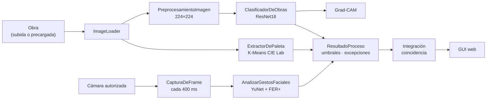
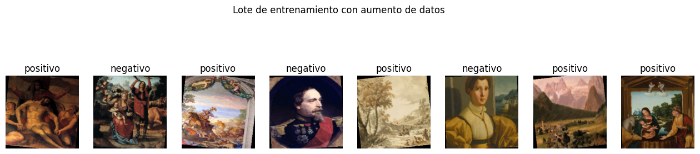
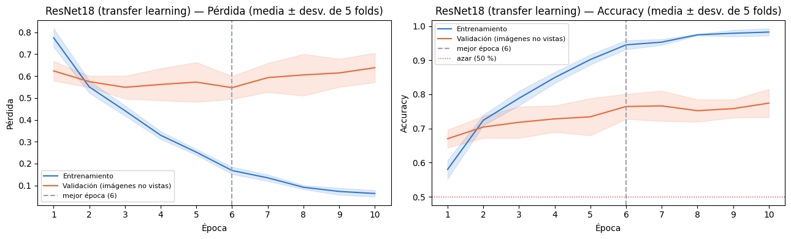
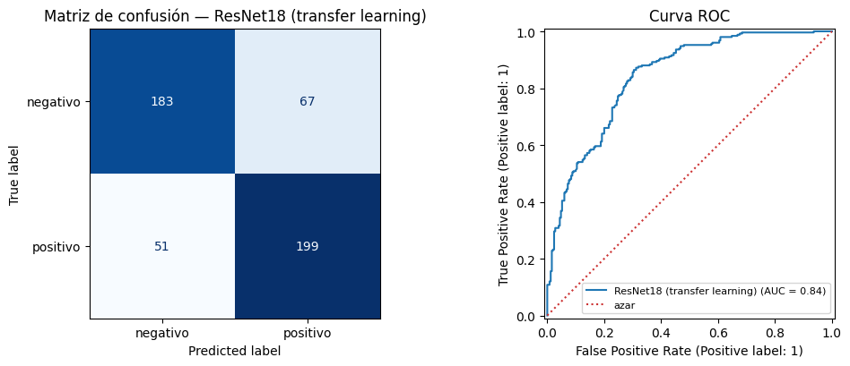

# Coincidencia emocional entre obra y visitante

**Procesamiento Digital de Imágenes · Universidad Autónoma de Occidente · 2026-2**
Jose Gabriel Castañeda Uribe · Juan José Osorio Reyes · Profesor: Nicolás Llanos Neuta

Sistema interactivo que clasifica el carácter emocional de una obra de arte con una CNN (*transfer learning*), lee la expresión facial del visitante que la observa (YuNet + FER+) y estima la **coincidencia emocional** entre ambas en una misma escala de valencia. Todo corre desde un notebook de Google Colab que entrena el modelo y levanta una aplicación web.

| | |
|---|---|
| 📓 Proyecto (notebook + interfaz) | [`proyecto/`](proyecto/) |
| 📘 Documentación técnica | [`docs/DOCUMENTACION.md`](docs/DOCUMENTACION.md) |
| 🧭 Arquitectura | [`docs/arquitectura.md`](docs/arquitectura.md) |
| 📊 Resultados | [`results/RESULTADOS.md`](results/RESULTADOS.md) |
| 📁 Dataset (Google Drive) | **[COMPLETAR: enlace con permiso de lectura]** |
| 🎬 Video demostrativo (≤ 3 min) | **[COMPLETAR: enlace]** |
| 🖼️ Póster | **[COMPLETAR: `docs/poster.pdf`]** |

---

## Estructura del repositorio

```
PDI-Coincidencia-Emocional/
├── proyecto/                         ← EL PROYECTO
│   ├── ProyectoPDI_Completo.ipynb    ← notebook completo (datos, entrenamiento, módulos, resultados, aplicativo)
│   └── frontend/                     ← interfaz web (la misma que sirve el notebook desde memoria)
│       ├── index.html
│       ├── styles.css
│       └── app.js
├── docs/
│   ├── DOCUMENTACION.md              ← qué hace cada celda, módulos, API, fórmulas, errores
│   ├── arquitectura.md               ← diagrama del sistema y tabla de módulos
│   └── gui/                          ← capturas de la interfaz
├── results/
│   ├── RESULTADOS.md                 ← métricas de la ejecución entregada
│   └── figuras/                      ← gráficas generadas por el notebook
├── requirements.txt
└── .gitignore
```

El notebook se entrega **con sus salidas**, así que en GitHub se ven las métricas y las gráficas sin ejecutarlo. Solo se borró la salida de la celda del túnel público, porque contenía direcciones IP.

---

## 1. Descripción

**Problemática.** En museos y exposiciones casi nunca se sabe si una obra produce en el visitante la emoción que su contenido sugiere. Las encuestas de salida son tardías y subjetivas.

**Justificación.** La visión computacional permite medir, sin contacto y en segundos, el carácter emocional de una obra (por su contenido y su paleta) y la expresión facial de quien la observa. Unir ambas lecturas en una escala de **valencia** (−1 desagradable … +1 agradable) da un indicador de cuánto *conecta* una obra con su público. El proyecto se enmarca en el eje **Análisis de la Expresión Humana en el Arte y la Cultura**.

**Objetivo general.** Diseñar, implementar y evaluar un sistema interactivo que estime la coincidencia emocional entre una obra de arte y la expresión facial del visitante.

**Objetivos específicos.**
1. Clasificar obras en *genera sentimientos positivos / negativos* con una CNN y explicar la decisión con Grad-CAM y la paleta cromática.
2. Detectar el rostro del visitante y reconocer su expresión a lo largo de una secuencia de fotogramas.
3. Integrar ambas lecturas en una medida de coincidencia y presentarla en una interfaz web con manejo de excepciones.
4. Evaluar el sistema con métricas cuantitativas.

**Solución.** Una aplicación web (FastAPI + HTML/CSS/JS) donde el visitante sube o elige una obra, la observa unos segundos frente a la cámara y recibe la clasificación de la obra, su expresión dominante y la coincidencia entre ambas.

---

## 2. Arquitectura



Detalle completo en [`docs/arquitectura.md`](docs/arquitectura.md).

---

## 3. Metodología

| Etapa | Qué se hizo |
|---|---|
| Datos | Se lee **cada imagen** de las carpetas `positivo/` y `negativo/` (sin importar mayúsculas en el nombre de la carpeta). Se validan, se detectan duplicados (MD5 y dHash) y se calcula la normalización |
| Partición | Validación cruzada **estratificada y por grupos de 5 folds**: los duplicados quedan siempre en el mismo fold, así no hay fuga de información |
| Modelo | **ResNet18** preentrenada en ImageNet. Se ajustan `layer4` y una capa final nueva (Dropout 0.5, Weight Decay 1e-4, AdamW con dos tasas de aprendizaje). Aumento de datos suave para no alterar el color |
| Selección | Se elige la época con menor pérdida media de validación (época 6 de 10). El modelo final se entrena con las 500 imágenes durante esas épocas |
| Comparación | La CNN del Parcial 2, entrenada desde cero con los mismos folds |
| Explicabilidad | Grad-CAM sobre `layer4` y paleta de 6 colores (K-Means en CIE Lab) |
| Rostro | YuNet (caja + 5 puntos), FER+ (8 emociones), gestos geométricos y aptitud del rostro (0-100) |
| Integración | Valencia de la obra = p(positivo) − p(negativo); valencia del visitante = Σ p(emoción) · valencia(emoción); **coincidencia = 1 − \|v_obra − v_visitante\| / 2** |

---

## 4. Datos

| Carpeta | Uso | Imágenes |
|---|---|---|
| `dataset usado/positivo` | Entrenamiento (clase 1) | 250 |
| `dataset usado/negativo` | Entrenamiento (clase 0) | 250 |
| `dataset usado/precarga-sin-analizar` | Imágenes **no vistas** por la CNN, para la GUI | 300 |

- **Origen y criterio de etiquetado:** **[COMPLETAR]**.
- **Calidad:** las 500 imágenes son válidas. Hay 2 grupos de casi duplicados (4 imágenes) y ninguno con etiquetas contradictorias.
- **Media RGB:** (0.457, 0.397, 0.341).



Ubicación en Google Drive (la ruta se configura en la celda `class config`):
```
Mi unidad/Proyecto Final PDI VERSION 3/
├── dataset usado/
│   ├── positivo/                 (o Positivo/)
│   ├── negativo/                 (o Negativo/)
│   └── precarga-sin-analizar/    (o «Precarga sin analizar»)
└── resultados_cnn/               ← lo crea el notebook (modelo y métricas)
```
Si la carpeta te la compartieron: drive.google.com → *Compartido conmigo* → clic derecho → *Organizar → Agregar acceso directo → Mi unidad*.

---

## 5. Resultados

Validación cruzada de 5 folds sobre 500 imágenes. Cada imagen la predijo un modelo que no la había visto.

| Modelo | Accuracy ± folds | Precision | Recall | F1 | AUC |
|---|---|---|---|---|---|
| **ResNet18 (transfer learning)** | **0.764 ± 0.037** | 0.748 | 0.796 | **0.771** | **0.842** |
| CNN Parcial 2 | 0.642 ± 0.021 | 0.643 | 0.640 | 0.641 | 0.708 |

| Curvas ResNet18 | Matriz de confusión y ROC |
|---|---|
|  |  |

- El *transfer learning* mejora 12 puntos de accuracy frente a la CNN entrenada desde cero, con los mismos folds.
- La pérdida de validación es mínima en la época 6 y después sube mientras el entrenamiento sigue mejorando: es **sobreajuste**, y por eso el modelo final usa 6 épocas.
- El 91.2 % de las predicciones tiene confianza ≥ 60 %, y en ellas la accuracy es 0.789.

Tablas por fold, por clase y todas las figuras en [`results/RESULTADOS.md`](results/RESULTADOS.md).

---

## 6. Interfaz gráfica

| Pestaña / paso | Funcionalidad |
|---|---|
| **Obra y visitante** · Entrada | Cargar obra (JPG/PNG ≤ 10 MB) o usar una precargada. Cámara con consentimiento y vista en vivo (emoción, rostro, aptitud) |
| Análisis | Observación de 3, 6 o 10 s con la obra en pantalla completa; avance por módulo |
| Excepciones | Avisos comprensibles: imagen oscura o borrosa, rostro no detectado, confianza baja… |
| Resultado | Obra con Grad-CAM y regiones, medidor de coincidencia, escala de valencia, emociones, gestos, línea de tiempo, tiempos por módulo. Exportable a JSON o PDF |
| **Imágenes precargadas** | Análisis por lotes de imágenes no vistas por la CNN, con su coherencia obra ↔ rostro |
| Acerca del modelo | Arquitectura, métricas de la validación cruzada, curvas y fórmula |

| Entrada | Resultado |
|---|---|
|  |  |

> **[COMPLETAR]** Guarda las capturas en `docs/gui/` con esos nombres.

---

## 7. Instalación y ejecución

### Google Colab (recomendado)
1. Sube el dataset a Drive con la estructura de la sección 4. Si usas otra ruta, cámbiala en `config.DRIVE_PROYECTO`.
2. Abre `proyecto/ProyectoPDI_Completo.ipynb` en Colab → *Entorno de ejecución → Cambiar tipo de entorno → **T4 GPU***.
3. *Entorno de ejecución → Ejecutar todo* y autoriza el acceso a Drive. Con GPU, el entrenamiento de los dos modelos tarda ~6-7 min.
4. La última celda crea un enlace `https://….loca.lt`. Ábrelo y escribe como contraseña la IP que muestra la celda. **No subas esa salida al repositorio.**

Con `REENTRENAR = False` en la celda de configuración se reutiliza el modelo guardado en `Drive/…/resultados_cnn/` y no se vuelve a entrenar.

### Local
```bash
pip install -r requirements.txt jupyter
jupyter notebook proyecto/ProyectoPDI_Completo.ipynb
# coloca el dataset en proyecto/dataset usado/ o ajusta config.DATASET_DIR
# la interfaz queda en http://127.0.0.1:8000
```

---

## 8. Conclusiones

**Resultados principales.** El sistema integra de extremo a extremo la clasificación de obras (accuracy de 0.764 y AUC de 0.84 en validación cruzada), la lectura facial en tiempo real y una medida de coincidencia explicable, en una interfaz con manejo de excepciones.

**Limitaciones.**
- Dataset pequeño (500 imágenes) con etiquetas binarias y subjetivas: parte de los errores son obras discutibles (ver *errores más seguros*).
- Sobreajuste a partir de la época 6.
- El modelo da probabilidades muy extremas, y eso empuja la valencia de la obra hacia ±1.
- La expresión facial no equivale a la emoción sentida. Ante el arte predomina la cara neutral, lo que limita la coincidencia a ~50 % frente a obras clasificadas con seguridad.
- FER+ se entrenó con fotografías: su lectura de rostros pintados dentro de las obras es solo informativa.

**Mejoras.** Más datos y etiquetas graduadas (varias personas por obra), calibrar las probabilidades, usar solo la parte expresiva del rostro en la coincidencia, y una **prueba con visitantes reales** que compare lo que el sistema detecta con lo que las personas reportan.

---

## Referencias
- He, K. et al. (2016). *Deep Residual Learning for Image Recognition*. CVPR.
- Barsoum, E. et al. (2016). *Training Deep Networks for Facial Expression Recognition with Crowd-Sourced Label Distribution* (FER+). ICMI.
- Wu, W. et al. (2023). *YuNet: A Tiny Millisecond-level Face Detector*. Machine Intelligence Research.
- Selvaraju, R. R. et al. (2017). *Grad-CAM: Visual Explanations from Deep Networks via Gradient-based Localization*. ICCV.
