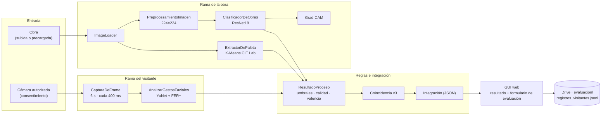

# Coincidencia emocional entre obra y visitante

**Procesamiento Digital de Imágenes · Universidad Autónoma de Occidente · 2026-2**
Jose Gabriel Castañeda Uribe · Juan José Osorio Reyes · Profesor: Nicolás Llanos Neuta

Sistema interactivo que clasifica el carácter emocional de una obra de arte (CNN con *transfer learning*), lee la expresión facial del visitante que la observa (YuNet + FER+) y estima la **coincidencia emocional** entre ambas en una misma escala de valencia. Incluye una interfaz web y una evaluación con visitantes reales.

| | |
|---|---|
| 🎬 Video demostrativo (≤ 3 min) | **[COMPLETAR: enlace]** |
| 🖼️ Póster académico | **[COMPLETAR: `docs/poster.pdf`]** |
| 📁 Dataset (Google Drive) | **[COMPLETAR: enlace con permiso de lectura]** |
| 🧠 Pesos del modelo `cnn_obras.pt` | **[COMPLETAR: enlace de Drive o GitHub Releases]** |
| 📓 Notebook principal | [`ProyectoPDI_Completo_v3.ipynb`](ProyectoPDI_Completo_v3.ipynb) |

---

## Contenido
1. [Descripción del proyecto](#1-descripción-del-proyecto)
2. [Arquitectura del sistema](#2-arquitectura-del-sistema)
3. [Metodología](#3-metodología)
4. [Implementación](#4-implementación)
5. [Datos](#5-datos)
6. [Interfaz gráfica de usuario](#6-interfaz-gráfica-de-usuario)
7. [Resultados](#7-resultados)
8. [Conclusiones](#8-conclusiones)
9. [Instalación y ejecución](#9-instalación-y-ejecución)
10. [Referencias](#10-referencias)

---

## 1. Descripción del proyecto

### Problemática
En museos y exposiciones casi nunca se sabe si una obra produce en el visitante la emoción que su contenido sugiere. Las encuestas de salida son tardías y subjetivas, y no dicen nada del momento de la observación. Tampoco hay una forma accesible de que el visitante compare su reacción con el carácter emocional de la obra.

### Justificación
La visión computacional permite medir, sin contacto y en segundos, dos cosas: el carácter emocional de una obra (por su contenido y su paleta) y la expresión facial de quien la observa. Unir ambas lecturas en una escala de **valencia** (−1 desagradable … +1 agradable) da a curadores y educadores un indicador de cuánto *conecta* una obra con su público. Al visitante le ofrece una experiencia interactiva para reflexionar sobre su propia reacción. El proyecto se enmarca en el eje del curso **Análisis de la Expresión Humana en el Arte y la Cultura**.

### Objetivos
**General.** Diseñar, implementar y evaluar un sistema interactivo que estime la coincidencia emocional entre una obra de arte y la expresión facial del visitante que la observa.

**Específicos.**
1. Clasificar obras en *genera sentimientos positivos / negativos* con una CNN (ResNet18 con *transfer learning*) y explicar la decisión con Grad-CAM y la paleta cromática.
2. Detectar el rostro del visitante (YuNet) y reconocer su expresión (FER+) a lo largo de una secuencia de fotogramas.
3. Integrar ambas lecturas en una medida de coincidencia y presentarla en una interfaz web con manejo de excepciones.
4. Evaluar el sistema con métricas cuantitativas: validación cruzada de la CNN, rendimiento y una prueba con visitantes reales capturados por el equipo.

### Solución propuesta
Una aplicación web (FastAPI + HTML/CSS/JS) donde el visitante sube o elige una obra, la observa unos segundos frente a la cámara y recibe tres cosas: la clasificación de la obra (con Grad-CAM y paleta), su expresión dominante y la coincidencia entre ambas. El equipo usa la misma interfaz para registrar la evaluación: el visitante dice qué sintió y si está de acuerdo con el resultado, y esas respuestas se comparan con la salida del sistema.

---

## 2. Arquitectura del sistema



El diagrama completo (endpoints de la API, almacenamiento, flujo de entrenamiento y evaluación) y la tabla de módulos con sus entradas, salidas y técnicas están en **[`docs/arquitectura.md`](docs/arquitectura.md)**.

---

## 3. Metodología

| Etapa | Qué se hizo | Técnicas / modelos |
|---|---|---|
| 1. Datos | Inventario imagen por imagen, validación (JPG/PNG, > 32 px), duplicados exactos (MD5) y casi idénticos (dHash de 64 bits, ≤ 4 bits de diferencia) | Pillow, hashing perceptual |
| 2. Partición | Validación cruzada **estratificada y por grupos** de 5 folds: las imágenes casi idénticas caen siempre en el mismo fold, para que no haya fuga de información | `StratifiedGroupKFold` |
| 3. Clasificación de obras | ResNet18 preentrenada en ImageNet. Se ajustan `layer4` y una capa final nueva (Dropout 0.5, Weight Decay 1e-4, AdamW con LR diferenciada). Aumento de datos suave (recorte, volteo, rotación, ligero ColorJitter) para no alterar el color, que también comunica emoción. Se elige la época con menor pérdida media de validación y el modelo final se entrena con las 500 imágenes | *Transfer learning*, AMP en GPU |
| 4. Comparación | La CNN propia del Parcial 2 y una **línea base de solo color** (regresión logística sobre un histograma HSV y *colorfulness*), con los mismos folds | Prueba de que el contenido aporta más que la paleta |
| 5. Explicabilidad | Grad-CAM sobre `layer4`, regiones relevantes y paleta de 6 colores (K-Means en CIE Lab) | Grad-CAM, K-Means |
| 6. Rostro | Detección con YuNet (caja + 5 puntos), 8 emociones con FER+, gestos geométricos (inclinación, giro, ancho de boca) y una **aptitud del rostro** de 0-100 (30 % detector, 20 % tamaño, 20 % frontalidad, 15 % nitidez, 15 % iluminación) | YuNet (OpenCV Zoo), FER+ (ONNX Model Zoo) |
| 7. Integración | Valencia de la obra = p(pos) − p(neg). La del visitante sale de la valencia de cada emoción (felicidad +1 … enojo −0.9). **Coincidencia = 1 − \|v_obra − v_visitante\| / 2** | Reglas de aceptación, umbrales y excepciones |
| 8. Evaluación | Métricas de la CNN, latencia, y prueba con visitantes reales (protocolo en [`docs/protocolo_evaluacion.md`](docs/protocolo_evaluacion.md)) | Accuracy, F1, AUC, κ de Cohen, Spearman, IC de Wilson, SUS |

### Fórmula de coincidencia v3 (cambio respecto a la versión anterior)
En la versión 2, una cara neutral (valencia 0) fijaba la coincidencia en ~50 % frente a cualquier obra clasificada con seguridad. Eso ocurre con frecuencia, porque la mayoría de las personas mira el arte con expresión neutral. La **v3** usa la valencia de la parte *expresiva* del rostro, `v / (1 − p(neutral))`, y reporta la **intensidad** `1 − p(neutral)`. Si la intensidad es menor de 0.30, el resultado se marca como *poco concluyente*. Ambas fórmulas se guardan en cada prueba con visitantes, y la sección 6 del notebook mide cuál reproduce mejor lo que reportan las personas. Se puede cambiar con `config.FORMULA_COINCIDENCIA`.

---

## 4. Implementación

```
├── ProyectoPDI_Completo_v3.ipynb   ← todo el proyecto (Colab, «Ejecutar todo»)
├── frontend/                       ← GUI exportada por el notebook (index.html, styles.css, app.js)
├── results/                        ← métricas, tablas y figuras generadas (RESULTADOS.md)
├── models/                         ← metricas_cnn.json y predicciones_por_imagen.csv
├── docs/
│   ├── arquitectura.md             ← diagramas completos y tabla de módulos
│   ├── protocolo_evaluacion.md     ← protocolo, SUS y consentimiento informado
│   └── gui/                        ← capturas de la interfaz
├── evaluacion/                     ← plantillas protocolo_offline.csv y sus.csv
└── requirements.txt
```

Secciones del notebook:

| Sección | Funcionalidad principal |
|---|---|
| 1. Configuración | Instala lo que falta. **Una sola celda** con todas las rutas y parámetros (`class config`). Cada `plt.show()` guarda la figura en `results/figuras/` |
| 2. Dataset | `inventario_dataset`, `agrupar_duplicados`, descripción visual del dataset, folds, `DatasetPrecarga` (imágenes no vistas) |
| 3. Entrenamiento y módulos | `validacion_cruzada`, `entrenar_final`, `ClasificadorDeObras` + Grad-CAM, `ExtractorDePaleta`, `AnalizarGestosFaciales`, `ResultadoProceso`, `Sistema` (integración), `RegistroEvaluacion` |
| 4. Resultados | Curvas, matriz de confusión, ROC, tabla imagen por imagen, galerías de errores, línea base de color, ejemplo con una imagen no vista, latencia y fps |
| 5. Aplicativo | HTML/CSS/JS servidos por FastAPI (11 endpoints), servidor en segundo plano, enlace de Colab o Localtunnel |
| 6. Evaluación con visitantes | Plantillas, procesamiento de videos (opción B), métricas del sistema completo |
| 7. Análisis | Logros, limitaciones, mejoras, conclusiones y `results/RESULTADOS.md` automático |
| 8. Exportar | Escribe `frontend/`, `results/`, `models/` y `requirements.txt` para este repositorio |

API principal: `POST /api/analizar` (obra + fotogramas), `POST /api/frame` (vista en vivo), `POST /api/evaluacion` (formulario), `GET /api/metricas`, `GET /api/dataset/*` (imágenes precargadas).

---

## 5. Datos

| Conjunto | Uso | Tamaño | Enlace |
|---|---|---|---|
| `dataset usado/positivo` y `negativo` | Entrenamiento y validación cruzada de la CNN | 250 + 250 imágenes | **[COMPLETAR]** |
| `dataset usado/precarga-sin-analizar` | Imágenes **no vistas** para la GUI, el ejemplo, la latencia y la evaluación con visitantes | 350 imágenes | **[COMPLETAR]** |
| `evaluacion/` | Registros de la prueba con visitantes (sin imágenes del rostro) | según la prueba | **[COMPLETAR]** |

**Origen y etiquetado:** **[COMPLETAR: de dónde salieron las imágenes (p. ej. WikiArt / ArtEmis / recolección propia) y con qué criterio se asignó cada una a `positivo/` o `negativo/`]**.

**Calidad:** se leyeron las 500 imágenes y todas fueron válidas. Hay 2 grupos de imágenes casi idénticas (4 imágenes), sin etiquetas contradictorias. La media RGB es (0.457, 0.397, 0.341). El resumen por imagen está en `results/dataset_resumen.csv`.

| Muestras por clase | Distribuciones (resolución, brillo, saturación) |
|---|---|
|  |  |

Estructura esperada en Google Drive:
```
Mi unidad/Proyecto-final-de-PDI/
├── dataset usado/{positivo, negativo, precarga-sin-analizar}/
├── resultados_cnn/        ← cnn_obras.pt y métricas (lo crea el notebook)
└── evaluacion/            ← registros de visitantes, videos, sus.csv (lo crea el notebook)
```

---

## 6. Interfaz gráfica de usuario

| Funcionalidad | Descripción |
|---|---|
| **Obra y visitante** | 4 pasos: *Entrada* (obra + cámara con consentimiento) → *Análisis* (avance por módulo) → *Excepciones* (mensajes comprensibles) → *Resultado* |
| Vista en vivo | Emoción actual, rostro detectado, aptitud e iluminación mientras la cámara está encendida |
| Observación | 3, 6 o 10 s mostrando la obra en grande. Se capturan fotogramas cada 400 ms |
| Resultado | Obra con regiones / Grad-CAM / rostros, medidor de coincidencia, escala de valencia, emociones, gestos, línea de tiempo y tiempos por módulo. Exportable a JSON y PDF |
| Imágenes precargadas | Análisis por lotes de imágenes aleatorias no vistas por la CNN |
| Evaluación del sistema | Formulario al final del resultado: emoción sentida, valencia percibida de la obra y acuerdo con la coincidencia. Se guardan solo números, nunca imágenes |
| Acerca del modelo | Arquitectura, métricas de validación cruzada, curva de entrenamiento y fórmula de coincidencia |

**Uso:**
1. Ejecuta el notebook y abre el enlace que imprime la celda *Abrir el aplicativo*.
2. Carga una obra (o usa *Usar una imagen precargada*).
3. Acepta el consentimiento → *Activar cámara* → *Iniciar observación* y mira la obra.
4. *Confirmar y analizar*. Revisa las excepciones, si las hay, y el resultado.
5. Si es una prueba con visitantes, llena *Evaluación del sistema* → *Guardar respuesta*.

| Paso 1 · Entrada | Paso 4 · Resultado | Formulario de evaluación |
|---|---|---|
|  |  |  |

> **[COMPLETAR]** Guarda las capturas en `docs/gui/` con esos nombres. Si tienen prototipos de Figma del Momento 2, agrégalos como `docs/gui/prototipo_*.png`.

---

## 7. Resultados

> Los valores de esta sección son de la **ejecución de referencia** (Colab, GPU T4, semilla 42). Cada ejecución del notebook regenera [`results/RESULTADOS.md`](results/RESULTADOS.md) con sus propias cifras.

### 7.1 Clasificación de obras: validación cruzada de 5 folds (500 imágenes)

| Modelo | Accuracy ± folds | Precision | Recall | F1 | AUC |
|---|---|---|---|---|---|
| **ResNet18 (transfer learning)** | **0.764 ± 0.037** | 0.748 | 0.796 | **0.771** | **0.842** |
| CNN Parcial 2 | 0.642 ± 0.021 | 0.643 | 0.640 | 0.641 | 0.708 |
| Línea base de color | **[ver RESULTADOS.md]** | | | | |

| Fold | 1 | 2 | 3 | 4 | 5 |
|---|---|---|---|---|---|
| Accuracy | 0.778 | 0.818 | 0.770 | 0.706 | 0.750 |
| AUC | 0.829 | 0.872 | 0.867 | 0.825 | 0.844 |

- Matriz de confusión: negativo 183 ✓ / 67 ✗ · positivo 199 ✓ / 51 ✗ (118 errores de 500).
- El 91.2 % de las predicciones supera el umbral de confianza del 60 %, y en ellas la accuracy sube a 0.789.

| Curvas de entrenamiento | Matriz de confusión y ROC |
|---|---|
|  |  |

| Separación entre clases | Comparación de modelos |
|---|---|
|  |  |

**Errores más seguros** (útiles para discutir el ruido de las etiquetas):


### 7.2 Ejemplo de funcionamiento (imagen no vista)


### 7.3 Rendimiento


**[COMPLETAR desde `results/rendimiento.json`]:** latencia total por obra ___ ms (p95 ___ ms) · análisis facial ___ fps.

### 7.4 Evaluación con visitantes reales
Protocolo: [`docs/protocolo_evaluacion.md`](docs/protocolo_evaluacion.md). **[COMPLETAR con la tabla de `results/RESULTADOS.md`]**

| Métrica | Valor | IC 95 % |
|---|---|---|
| Participantes / pruebas / obras | ___ / ___ / ___ | |
| Sesiones con rostro detectado | ___ | ___ |
| FER+ vs. emoción reportada (valencia neg/neu/pos) | ___ (κ = ___) | ___ |
| CNN vs. percepción del visitante (obras no vistas) | ___ (κ = ___) | ___ |
| Coincidencia v2 / v3: MAE frente a la reportada | ___ / ___ | |
| Acuerdo medio con la coincidencia (1-5) | ___ | |
| SUS (usabilidad) | ___ ± ___ | |


### 7.5 Análisis
- La CNN con *transfer learning* mejora en 12 puntos de accuracy a la CNN entrenada desde cero, con menos variación entre folds. Que también supere a la línea base de color indica que usa el contenido de la obra, no solo su paleta.
- Hay **sobreajuste**: desde la época 6 la accuracy de entrenamiento pasa de 0.95 y la pérdida de validación sube. Elegir la época por validación lo controla, pero el techo lo marcan las 500 imágenes y el ruido de las etiquetas.
- Las clases están equilibradas en los errores (recall 0.73 negativo / 0.80 positivo). El modelo tiende un poco a decir "positivo".
- **[COMPLETAR]** Qué mostró la prueba con visitantes: si FER+ captura lo que la gente siente, si la CNN coincide con la percepción humana en obras nuevas y qué fórmula de coincidencia funcionó mejor.

---

## 8. Conclusiones

**Principales resultados.** El sistema integra de extremo a extremo la clasificación de obras (≈ 76 % de accuracy y AUC de 0.84 en validación cruzada), la lectura facial en tiempo real y una medida de coincidencia explicable, en una GUI con manejo de excepciones. **[COMPLETAR con la evaluación con visitantes]**

**Limitaciones.**
- Dataset pequeño (500 imágenes) con etiquetas binarias y subjetivas.
- La expresión facial no equivale a la emoción sentida. Ante el arte predomina la cara neutral, y por eso los resultados con poca expresividad se marcan como poco concluyentes.
- FER+ se entrenó con fotografías: su lectura de rostros *pintados* dentro de las obras es solo informativa.
- La evaluación con visitantes tiene una muestra pequeña (IC amplios).
- El despliegue en Colab es temporal, sin autenticación y con CORS abierto.

**Oportunidades de mejora.** Etiquetas graduadas con varias personas por obra (p. ej. ArtEmis), más regularización o modelos como CLIP/ViT, un modelo conjunto CNN + color, más señales del visitante (mirada, tiempo de observación), calibrar la fórmula de coincidencia con los datos reales y desplegar en un servidor permanente para una prueba en un museo.

---

## 9. Instalación y ejecución

### Opción A · Google Colab (recomendada)
1. Sube el dataset a `Mi unidad/Proyecto-final-de-PDI/dataset usado/` con la estructura de la sección 5.
2. Abre `ProyectoPDI_Completo_v3.ipynb` en Colab → *Entorno de ejecución → Cambiar tipo de entorno → T4 GPU*.
3. *(Opcional, para no reentrenar)* copia `cnn_obras.pt`, `metricas_cnn.json`, `particion_cnn.json`, `predicciones_por_imagen.csv` y `validacion_cruzada.npz` a `Mi unidad/Proyecto-final-de-PDI/resultados_cnn/` y pon `REENTRENAR = False` en la celda de configuración.
4. *Entorno de ejecución → Ejecutar todo* y autoriza el acceso a Drive. Entrenar desde cero tarda ~8 min en una T4 (ResNet18 + comparación con la CNN del Parcial 2), más la lectura del dataset desde Drive.
5. Abre el enlace que imprime la celda **Abrir el aplicativo**. Para usarlo desde otro dispositivo, activa `USAR_TUNEL = True` en la celda de Localtunnel.

### Opción B · Local
```bash
git clone <URL-del-repositorio> && cd <repositorio>
python -m venv .venv && source .venv/bin/activate      # Windows: .venv\Scripts\activate
pip install -r requirements.txt jupyter
# Coloca el dataset en "./dataset usado/" o ajusta config.DATASET_DIR
jupyter notebook ProyectoPDI_Completo_v3.ipynb         # Kernel → Restart & Run All
# Abre http://127.0.0.1:8000
```
Requiere Python ≥ 3.10. Los modelos YuNet y FER+ se descargan solos la primera vez.

### Ejecutar la evaluación con visitantes
1. Sigue [`docs/protocolo_evaluacion.md`](docs/protocolo_evaluacion.md) usando el formulario de la GUI (opción A) o videos más `protocolo_offline.csv` (opción B).
2. Vuelve a ejecutar las secciones 6, 7 y 8 del notebook: se actualizan `results/RESULTADOS.md` y las figuras.

---

## 10. Referencias
- He, K. et al. (2016). *Deep Residual Learning for Image Recognition*. CVPR.
- Barsoum, E. et al. (2016). *Training Deep Networks for Facial Expression Recognition with Crowd-Sourced Label Distribution* (FER+). ICMI.
- Wu, W. et al. (2023). *YuNet: A Tiny Millisecond-level Face Detector*. Machine Intelligence Research. Modelo en [OpenCV Zoo](https://github.com/opencv/opencv_zoo).
- Selvaraju, R. R. et al. (2017). *Grad-CAM: Visual Explanations from Deep Networks via Gradient-based Localization*. ICCV.
- Hasler, D. & Süsstrunk, S. (2003). *Measuring colourfulness in natural images*. SPIE.
- Brooke, J. (1996). *SUS: A quick and dirty usability scale*.
- Achlioptas, P. et al. (2021). *ArtEmis: Affective Language for Visual Art*. CVPR.
