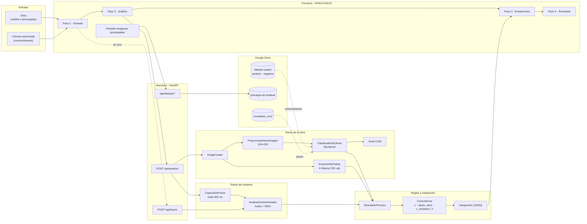

# Arquitectura del sistema

## Módulos

| Módulo | Entrada | Salida | Técnica |
|---|---|---|---|
| ImageLoader | bytes JPG/PNG (≤ 10 MB, ≥ 32 px) | matriz RGB | Pillow + corrección EXIF |
| PreprocesamientoImagen | RGB | tensor `[1, 3, 224, 224]` | redimensionado + normalización de ImageNet |
| ClasificadorDeObras | tensor | 2 logits (negativo, positivo) | ResNet18 preentrenada; se ajustan `layer4` y la capa final |
| Grad-CAM | tensor + clase | mapa de calor y regiones | gradientes de `layer4` |
| ExtractorDePaleta | RGB | 6 colores HEX con su proporción | K-Means en CIE Lab |
| CapturaDeFrame | cámara del navegador | fotogramas con marca de tiempo | getUserMedia, 1 cada 400 ms |
| AnalizarGestosFaciales | fotograma | cajas, 5 puntos, 8 emociones, gestos, aptitud | YuNet + FER+ (ONNX) |
| ResultadoProceso | salidas crudas | resultados validados + excepciones | softmax, umbrales, calidad, valencia |
| Integración | todo lo anterior | JSON para la GUI | coincidencia e interpretación en texto |
