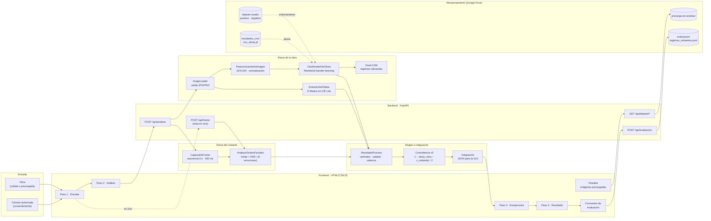
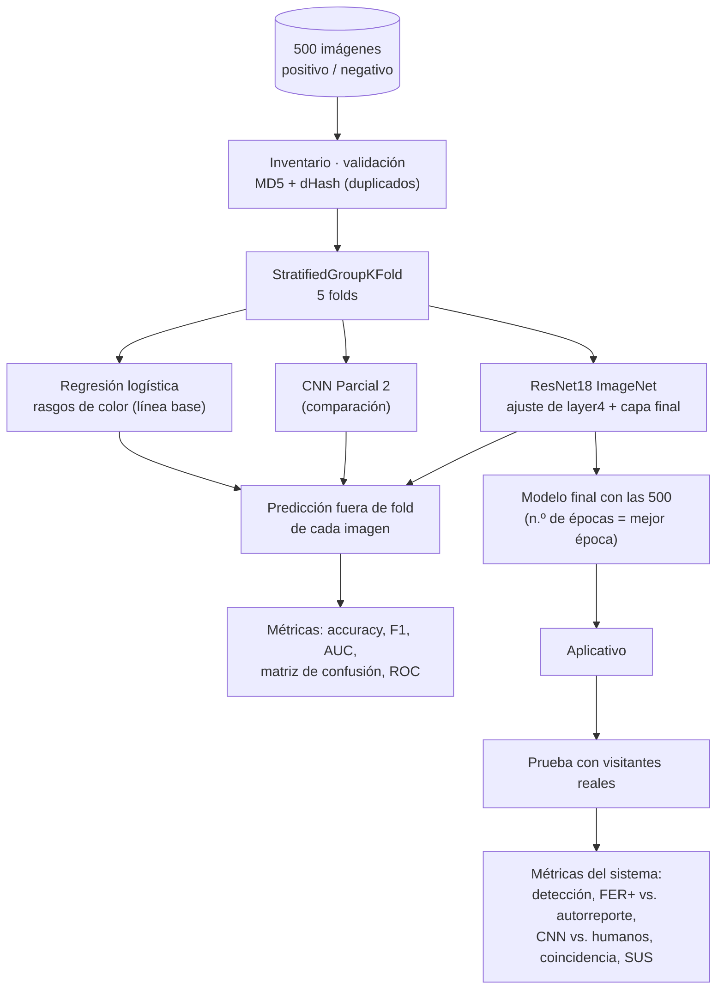

# Arquitectura del sistema

## Flujo de entrenamiento y evaluación

## Módulos

| Módulo | Entrada | Salida | Técnica |
|---|---|---|---|
| ImageLoader | bytes JPG/PNG (≤ 10 MB, > 32 px) | matriz RGB | Pillow + corrección EXIF; errores con código controlado |
| PreprocesamientoImagen | RGB de tamaño variable | tensor `[1, 3, 224, 224]` | redimensionado + normalización de ImageNet |
| ClasificadorDeObras | tensor | logits de 2 clases | ResNet18 preentrenada; se ajustan `layer4` y la capa final (Dropout 0.5, Weight Decay 1e-4) |
| Grad-CAM | tensor + clase | mapa de calor y regiones | gradientes de `layer4` |
| ExtractorDePaleta | RGB | 6 colores HEX con su proporción | K-Means en CIE Lab |
| CapturaDeFrame | cámara del navegador | secuencia de fotogramas con marca de tiempo | getUserMedia, 1 fotograma cada 400 ms |
| AnalizarGestosFaciales | fotograma RGB | cajas, 5 puntos, 8 emociones, gestos y aptitud del rostro | YuNet (OpenCV Zoo) + FER+ (ONNX Model Zoo) |
| ResultadoProceso | logits, paleta y detecciones | resultados validados + excepciones | softmax, umbrales, brillo y nitidez, valencia |
| Integración | todo lo anterior | JSON para la GUI | coincidencia v3 e interpretación en texto |
| RegistroEvaluacion | resultado + autorreporte | línea JSONL sin imágenes | evaluación con visitantes |
