# Resultados de la última ejecución

- Fuente de datos: Google Drive (/content/drive/MyDrive/Proyecto Final PDI VERSION 3/dataset usado)
- Imágenes válidas: positivo 400, negativo 400, precargadas 300 · descartadas 0
- Partición: entrenamiento 640 · validación 80 · prueba 80
- Preprocesamiento elegido por validación: sin filtros PDI

## CNN de obras (conjunto de prueba)

| Modelo | Accuracy | Precision | Recall | F1 |
|---|---|---|---|---|
| Modelo B (elegido) | 0.750 | 0.750 | 0.750 | 0.750 |

Matriz de confusión del modelo elegido [[neg→neg, neg→pos], [pos→neg, pos→pos]]: [[30, 10], [10, 30]]

## Agrupamiento no supervisado

- Obras etiquetadas: k = 2, silueta = 0.342, ARI con las etiquetas = 0.013 (k = 2: 0.013)
- Precargadas: k = 2, silueta = 0.342

## Neutralidad facial

- Variante «corregido» (AUC 0.82, 122 fotos del equipo). τ = 0.70 maximiza el índice de Youden: exactitud balanceada 77% con τ = 0.5 → 81% con τ calibrado.
- original: detección 100%, AUC 0.799, τ 0.73, exactitud balanceada 0.749 → 0.781
- corregido: detección 100%, AUC 0.818, τ 0.70, exactitud balanceada 0.774 → 0.814
- corregido_clahe: detección 100%, AUC 0.807, τ 0.49, exactitud balanceada 0.797 → 0.814

### Evaluación independiente (fotos de prueba no usadas para elegir τ)

- Fotos: calibración 85 · prueba 37 · variante corregido · τ = 0.70
- Detección de rostro en prueba: 100%
- AUC prueba: 0.801 · exactitud balanceada τ=0.5: 0.737 · con τ calibrado: 0.816
- Matriz [[neutral bien, neutral→no], [no→neutral, no neutral bien]]: [[18, 0], [7, 12]]

## Figuras

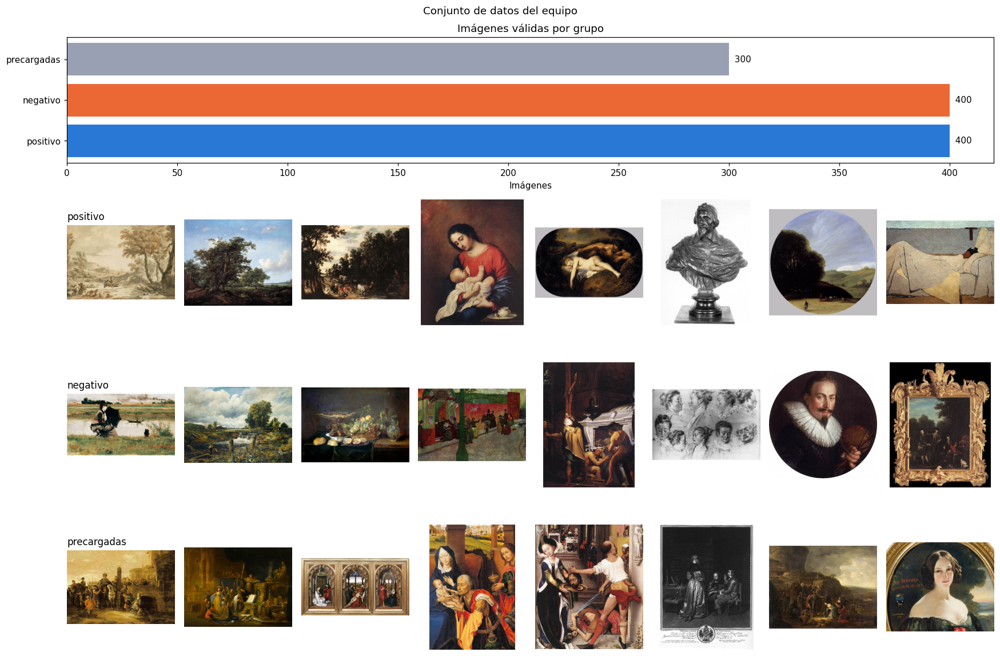
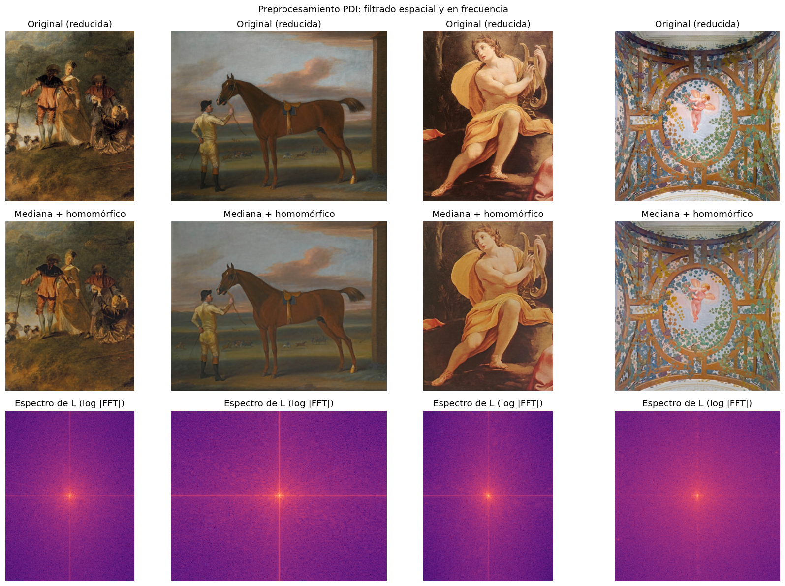
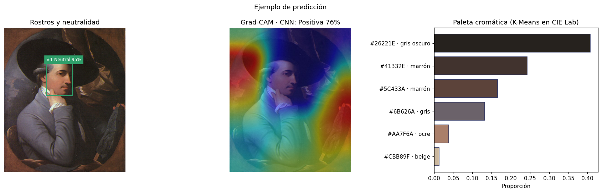
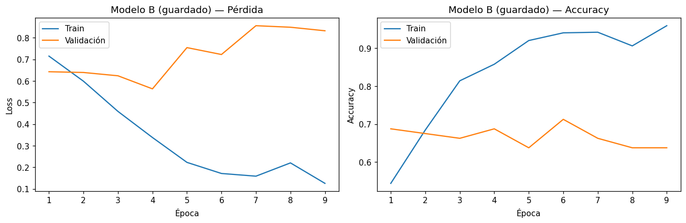
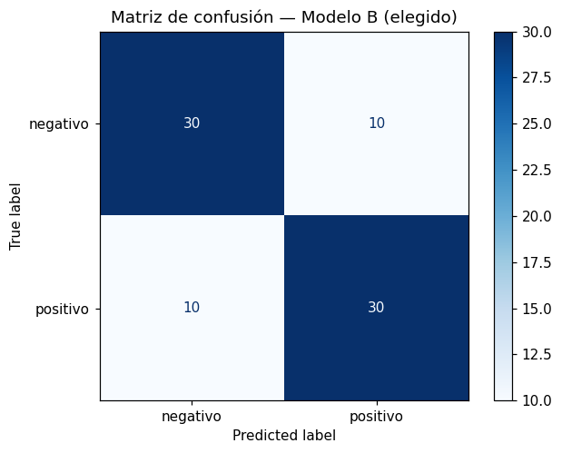
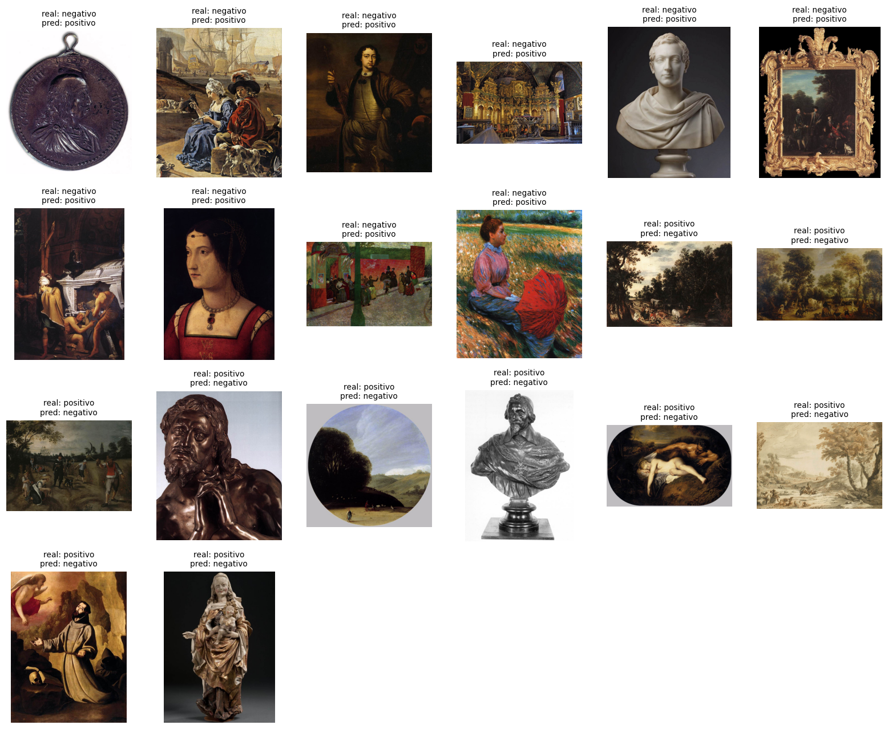
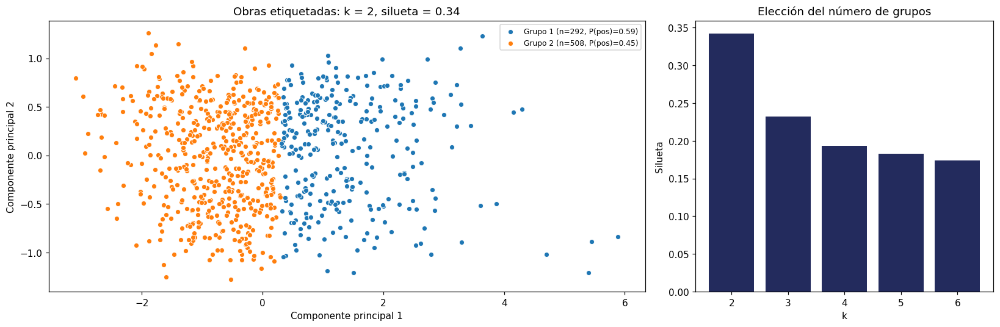
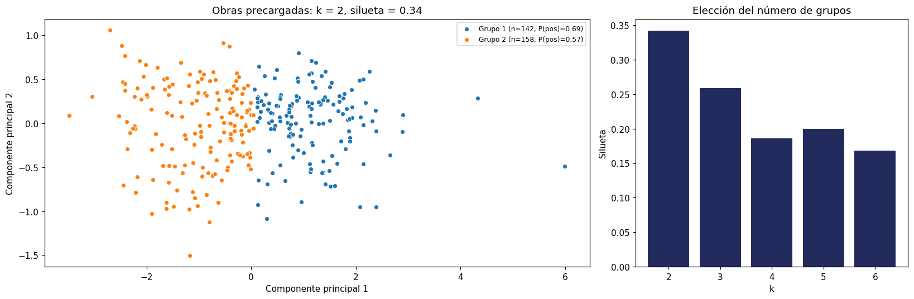
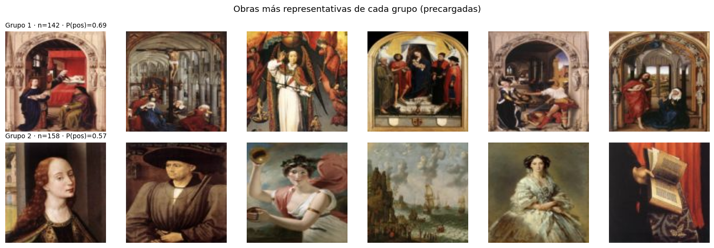
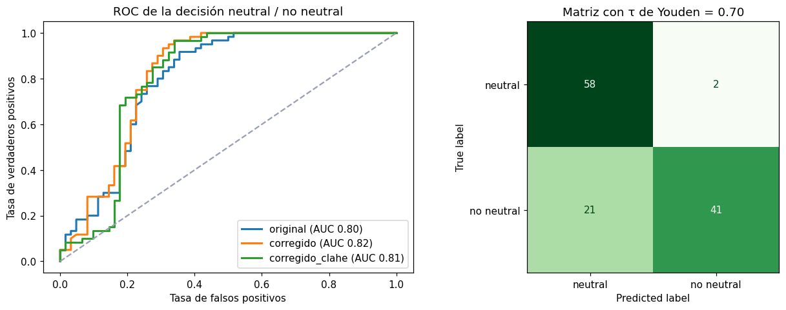
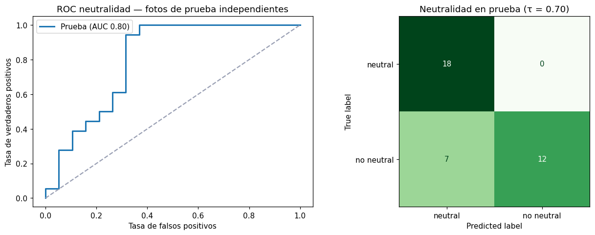
