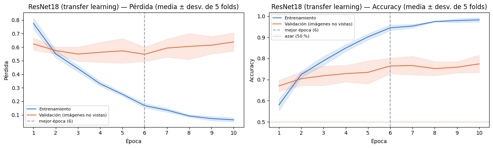
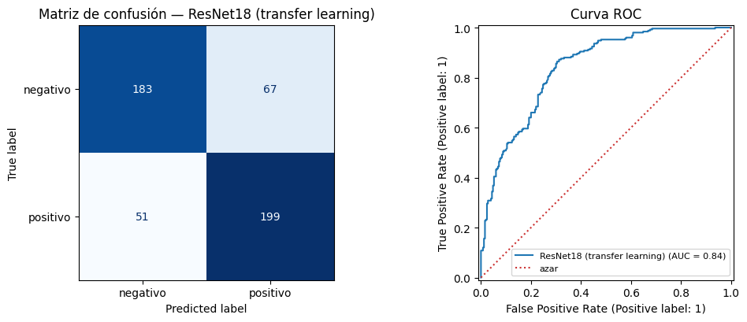
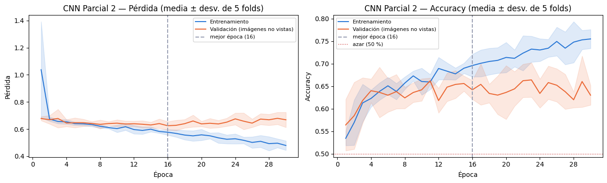
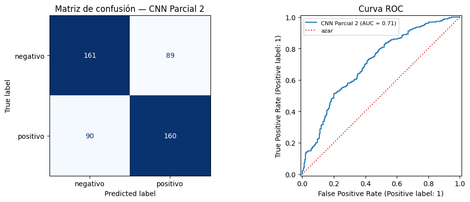
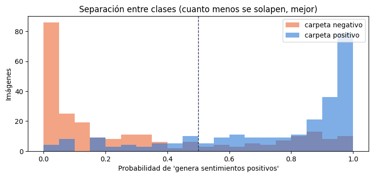
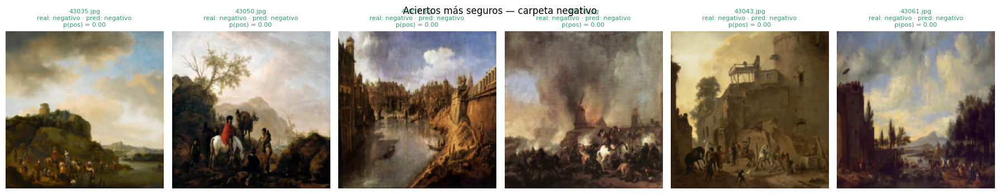
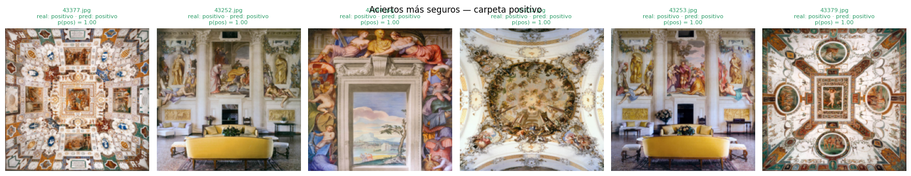
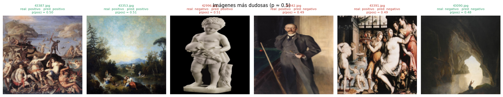
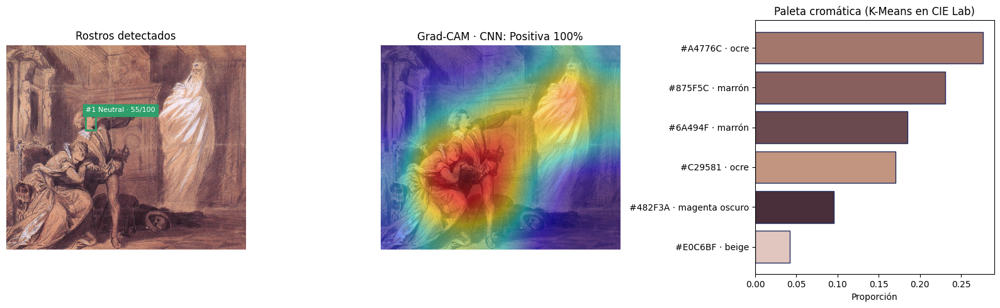

# Resultados · ejecución entregada

Google Colab · GPU Tesla T4 · semilla 42 · entrenamiento completo en 383 s.

## Dataset
| Clase | Imágenes válidas |
|---|---|
| negativo | 250 |
| positivo | 250 |
| **Total** | **500** (leídas en 9 s) |

Duplicados: 2 grupos (4 imágenes), 0 con etiquetas contradictorias · media RGB (0.4571, 0.3972, 0.3405) · desv. (0.2697, 0.2596, 0.2544).

| Fold | Entrena con | Evalúa con |
|---|---|---|
| 1 | 401 (201 pos / 200 neg) | 99 (49 pos / 50 neg) |
| 2 | 401 (201 pos / 200 neg) | 99 (49 pos / 50 neg) |
| 3 | 400 (200 pos / 200 neg) | 100 (50 pos / 50 neg) |
| 4 | 398 (198 pos / 200 neg) | 102 (52 pos / 50 neg) |
| 5 | 400 (200 pos / 200 neg) | 100 (50 pos / 50 neg) |

## Comparación de modelos (validación cruzada de 5 folds)
| Modelo | Mejor época | Accuracy ± folds | Precision | Recall | F1 | AUC | Parámetros entrenables |
|---|---|---|---|---|---|---|---|
| **ResNet18 (transfer learning)** | 6 de 10 | **0.764 ± 0.037** | 0.748 | 0.796 | **0.771** | **0.842** | 8.39 M de 11.18 M |
| CNN Parcial 2 | 16 de 30 | 0.642 ± 0.021 | 0.643 | 0.640 | 0.641 | 0.708 | 6.45 M |

## ResNet18 por fold
| Fold | n | Accuracy | Precision | Recall | F1 | AUC |
|---|---|---|---|---|---|---|
| 1 | 99 | 0.778 | 0.729 | 0.878 | 0.796 | 0.829 |
| 2 | 99 | 0.818 | 0.816 | 0.816 | 0.816 | 0.872 |
| 3 | 100 | 0.770 | 0.729 | 0.860 | 0.789 | 0.867 |
| 4 | 102 | 0.706 | 0.720 | 0.692 | 0.706 | 0.825 |
| 5 | 100 | 0.750 | 0.755 | 0.740 | 0.747 | 0.844 |

## ResNet18 por clase
| Clase real | Imágenes | Aciertos | Recall | Precision |
|---|---|---|---|---|
| negativo | 250 | 183 | 0.732 | 0.782 |
| positivo | 250 | 199 | 0.796 | 0.748 |

Matriz de confusión (filas = real, columnas = predicho): negativo `[183, 67]` · positivo `[51, 199]`.

**Confianza:** el 91.2 % de las predicciones tiene confianza ≥ 60 %, y en ellas la accuracy es 0.789. El resto se marca como *revisión requerida* en la GUI.

## Tiempos del flujo completo (una imagen, GPU T4)
| Módulo | ms |
|---|---|
| ImageLoader | 6.6 |
| Rostros en la obra | 91.8 |
| Paleta | 103.9 |
| Preprocesamiento | 6.0 |
| CNN | 55.5 |
| Grad-CAM | 75.8 |
| **Total** | **347.7** |

## Figuras
| | |
|---|---|
| Curvas ResNet18 |  |
| Matriz de confusión y ROC ResNet18 |  |
| Curvas CNN Parcial 2 |  |
| Matriz de confusión y ROC CNN Parcial 2 |  |
| Separación entre clases |  |
| Errores más seguros |  |
| Aciertos más seguros (negativo) |  |
| Aciertos más seguros (positivo) |  |
| Imágenes más dudosas (p ≈ 0.5) |  |
| Ejemplo del flujo completo |  |

> **Nota sobre el ejemplo:** la imagen 43283.jpg forma parte del entrenamiento. La validación cruzada (modelo que no la vio) la predijo *negativa 81 %*, mientras que el modelo final, que sí la vio, la clasifica *positiva 100 %*. La cifra que mide el desempeño real es la de la validación cruzada.

## Análisis
- El *transfer learning* mejora 12.2 puntos de accuracy y 0.13 de AUC frente a la CNN desde cero, con la misma partición.
- La variación entre folds (0.706 a 0.818) es la esperable con ~100 imágenes por fold. El intervalo de confianza del 95 % de la accuracy global es aproximadamente [0.73, 0.80].
- Desde la época 6, la pérdida de entrenamiento sigue bajando y la de validación sube (0.55 → 0.64): hay sobreajuste, controlado al elegir esa época.
- El histograma de separación muestra probabilidades muy concentradas cerca de 0 y 1: el modelo es muy seguro incluso en algunos errores.
